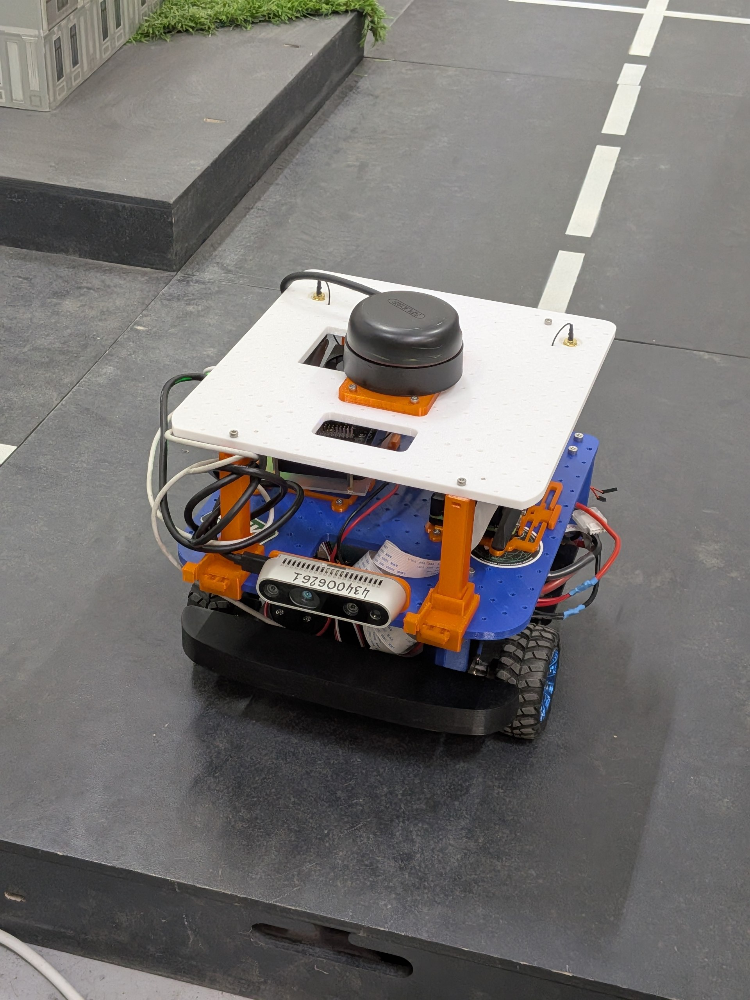
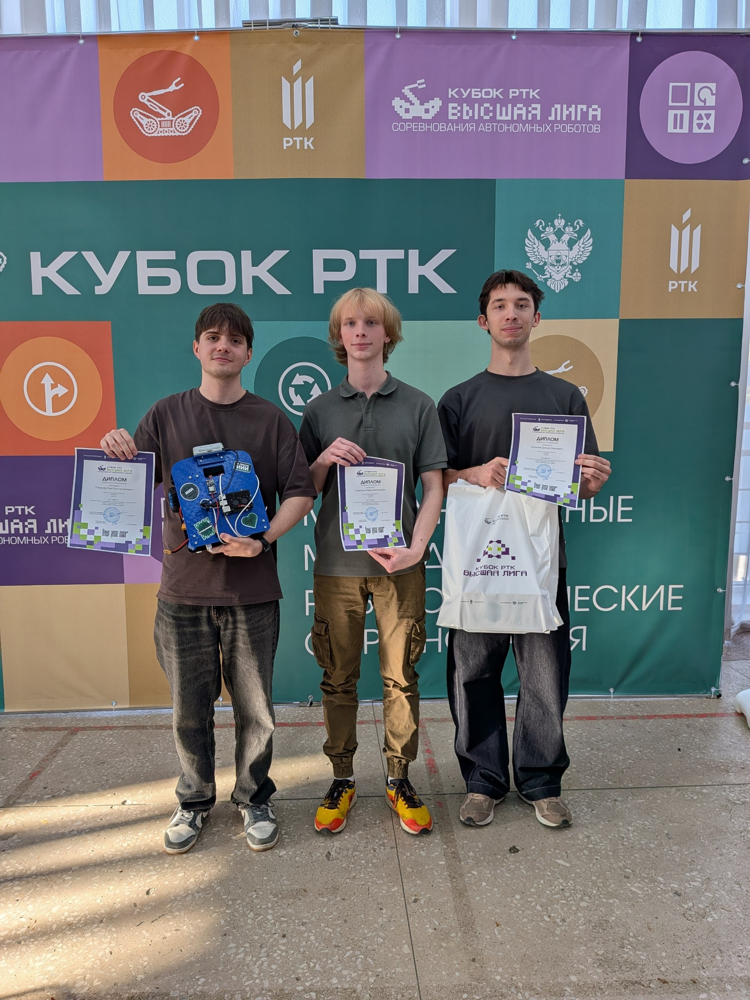
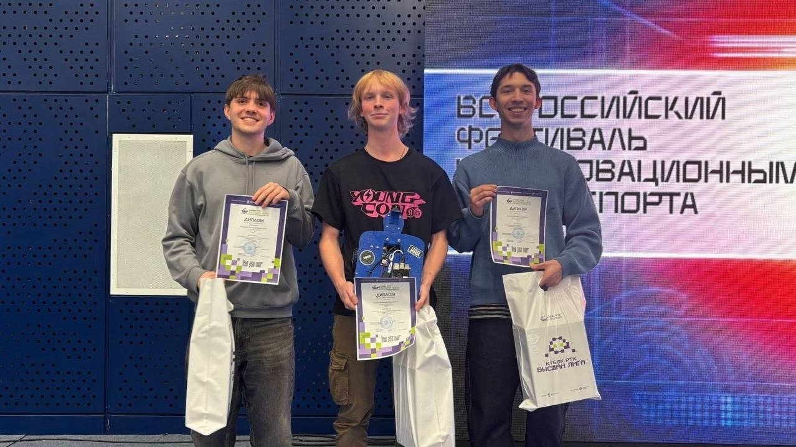
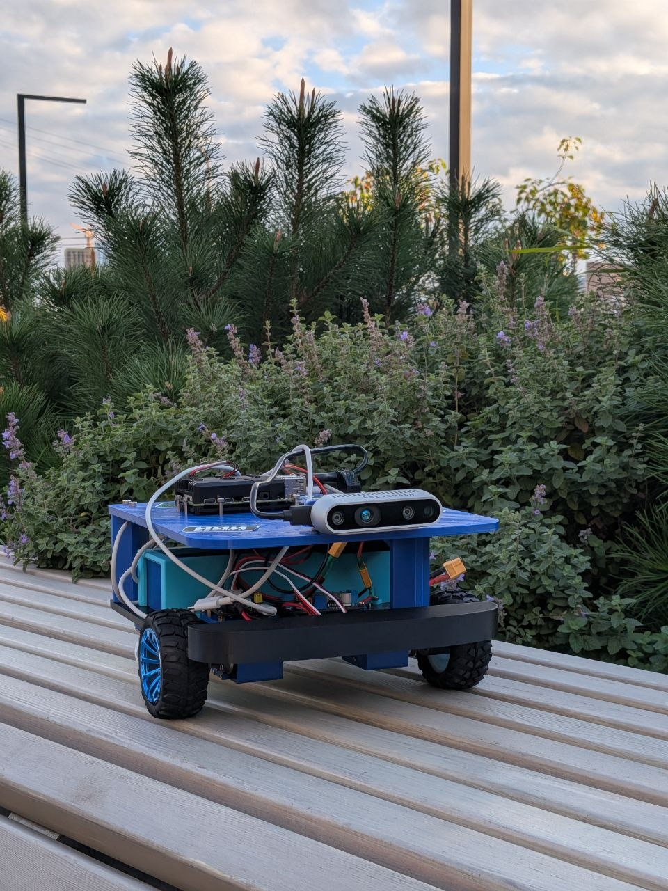
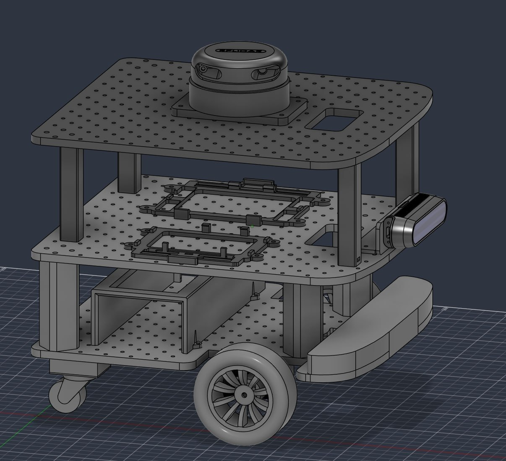

# IJKbot — автономный мобильный робот на ROS 2

[](https://docs.ros.org/en/jazzy/)
[](docs/JETSON_ORIN_MIGRATION.md)
[](docs/OPERATOR_GUIDE.md#сборка-и-тесты)
[](LICENSE)

"Тот самый робот" (IJKbot) — двухколёсная платформа команды «Унесённые роботом» из РТУ МИРЭА. Робот строит карту по лидару и камере глубины, прокладывает маршрут и выполняет миссию поиска пострадавшего на учебном полигоне. Текущая конфигурация использует Jetson Orin Nano и ROS 2 Jazzy. Веб-пульт и RViz работают на ноутбуке оператора.

<p align="center">
  
  <br><sub>"Тот самый робот" на полигоне в РТУ МИРЭА</sub>
</p>

## Кубок РТК. Высшая лига

Результаты команды «Унесённые роботом» на хакатоне «Эвакуация» в 2026 году:

- **1-е место в Ижевске.** [Итоги этапа от ИжГТУ](https://istu.ru/news/zhizn-universiteta/itogi-regionalnogo-etapa-sorevnovaniy-kubok-rtk)
- **2-е место в Раменском.** [Сообщение РТУ МИРЭА об этапе](https://t.me/rtumirea_official/25637)

<p align="center">
  
  
  <br><sub>Команда "Унесённые роботом" на награждениях Кубка РТК</sub>
</p>

## Возможности

- **Управление.** Веб-пульт `./ijk ui` запускает профили, показывает телеметрию и связь, даёт доступ к джойстику и E-STOP. Есть ручное управление с клавиатуры и DualShock 4.
- **Картографирование.** SLAM Toolbox строит 2D-карту по лидару. В режиме `mapping --3d` RTAB-Map объединяет сканы лидара, цвет и глубину RealSense, а также колёсную одометрию. В одном окне RViz видны 2D-сетка, цветной 3D-слой и превью камеры.
- **Навигация.** Nav2 планирует по сохранённой 2D-карте. В режиме с D435 измерения глубины обновляют карту препятствий, в том числе для объектов ниже плоскости лидара.
- **«Эвакуация».** Соревновательный профиль интерпретирует задание через Ollama, ведёт робота к зоне поиска, использует наблюдения фигурки и QR-кода и фиксирует ход попытки на судейском экране. [Подготовка и выполнение миссии](src/brain/README.md)

## Конструкция

### Развитие платформы

<table>
  <thead>
    <tr>
      <th width="50%">Ранняя версия</th>
      <th width="50%">Текущая версия</th>
    </tr>
  </thead>
  <tbody>
    <tr>
      <td align="center"></td>
      <td align="center"></td>
    </tr>
    <tr>
      <td>Открытая компоновка с камерой на переднем крае синей верхней площадки.</td>
      <td>Дополнительный верхний ярус на оранжевых стойках. Лидар установлен сверху, а RealSense закреплена спереди под ним.</td>
    </tr>
  </tbody>
</table>

На фотографиях видны изменения компоновки датчиков и креплений. Двухколёсная база с передним бампером сохранилась в обеих версиях.

### CAD-модель

<p align="center">
  
  <br><sub>CAD-модель шасси и креплений датчиков</sub>
</p>

### Аппаратный стек

| Компонент | Конфигурация и назначение |
| --- | --- |
| Бортовой компьютер | NVIDIA Jetson Orin Nano 8 ГБ, обработка RGB-D, одометрия, картографирование и Nav2. Альтернативная конфигурация — Raspberry Pi 4B. |
| Лидар | Slamtec RPLIDAR A2M8, двумерные сканы окружения, UART 115200 бод. |
| Камера глубины | Intel RealSense D435 по USB 3.0, цвет и глубина для 3D-карты и обнаружения препятствий. Цветовой режим через `./ijk` по умолчанию — `1920x1080x15`. |
| Приводы | 2 × Feetech STS3215, ID 1 и 2, UART 1 000 000 бод через Waveshare USB-to-UART. |
| Шасси | Дифференциальный привод, ведущие колёса диаметром 75 мм, колея 225 мм, две задние пассивные опоры. |
| Питание | Аккумулятор LiPo 4S, 14,8 В, 5000 мА·ч. |
| Ноутбук оператора | NVIDIA GeForce RTX 5060 с 8 ГБ VRAM, веб-пульт, RViz и локальная LLM для миссии. |
| Связь и управление | Wi-Fi 5 ГГц, SSH, клавиатура, DualShock 4 или браузерный джойстик. |

### Технический стек

| Подсистема | Технологии |
| --- | --- |
| ОС и ROS | Ubuntu 24.04, ROS 2 Jazzy, `rclcpp` и `rclpy`. На ноутбуке поддерживается окружение Pixi. |
| Языки и сборка | C++17, Python 3.12, CMake, ament и colcon. Конфигурация в YAML, модель робота в URDF/Xacro. |
| Картографирование | SLAM Toolbox для 2D, RTAB-Map для объединения RGB-D, лидара и колёсной одометрии. |
| Навигация | Nav2, AMCL, планировщик Navfn, Regulated Pure Pursuit, слои стоимости и собственный `FloorVoxelLayer`. Команды проходят через `twist_mux` и бортовой monitor. |
| Компьютерное зрение | RealSense ROS, OpenCV, NumPy, QR-декодер ZXing. YOLO-детектор фигурки с отдельно заданной моделью поддерживает Ultralytics, ONNX Runtime и TensorRT. |
| Миссия и LLM | Автомат состояний на Python, Ollama с `qwen3.5:9b`, структурированные JSON-ответы с проверкой Pydantic. |
| Интерфейсы | Веб-пульт на aiohttp с WebSocket, судейский дашборд на NiceGUI, визуализация в RViz2. |
| Обмен данными | CycloneDDS, `ROS_DOMAIN_ID=42`, TF2, синхронизация часов через Chrony. На ноутбук выводятся уменьшенное JPEG-превью и прореженное 3D-представление. |
| Проверки | pytest для Python и CLI, GTest для C++, `colcon test` для ROS-пакетов. |

## Структура репозитория

```text
IJKbot/
├── ijk                  # Единая точка входа CLI и веб-пульта
├── config/              # Общие настройки и локальные переопределения
├── src/                 # ROS 2 пакеты
│   ├── driver/          # STS3215, UART, одометрия и watchdog
│   ├── description/     # URDF/Xacro, геометрия шасси и TF датчиков
│   ├── bringup/         # Launch-файлы профилей, датчики и бортовой monitor
│   ├── nav2/            # Навигация, costmaps, карты, twist_mux и RViz
│   ├── terrain/         # RGB-D, фильтрация глубины, слои Nav2 и проезд мостов
│   ├── vision/          # Детекция фигурки, QR и координаты наблюдений
│   ├── vision_cpp/      # Нативный захват CSI-камеры и обработка QR
│   └── brain/           # LLM, автомат миссии, семантическая карта и дашборд
├── tools/ijk/           # Реализация CLI, поиск робота, профили и веб-сервер
├── scripts/             # Диагностика, калибровка и сервисные утилиты
├── tests/               # Проверки CLI, веб-пульта и взаимодействия модулей
├── docs/                # Руководства, регламенты и проектные документы
└── pics/                # Фотографии и изображения конструкции
```

Профили `competition`, `showcase`, `teleop`, `mapping` и `navigate` используют общие настройки оборудования из [config/ijk.yaml](config/ijk.yaml). Параметры конкретного робота задаются в `config/ijk.local.yaml`. Тесты отдельных ROS-пакетов также находятся рядом с их исходниками в `src/`.

## Быстрый старт

На борту нужны собранный workspace с ROS 2 Jazzy, доступ по SSH и установленные драйверы датчиков. Для 3D-режима нужны RealSense ROS и RTAB-Map. На ноутбуке понадобятся ROS 2 Jazzy, собранное окружение IJKbot и зависимости веб-пульта. [Подготовка Orin](docs/JETSON_ORIN_MIGRATION.md) · [Сборка и проверка](docs/OPERATOR_GUIDE.md#сборка-и-тесты)

В локальном `config/ijk.local.yaml` на ноутбуке укажите свои значения:

```yaml
network:
  default_user: orin
  remote_ws: /home/orin/IJKbot
  known_hosts: ["192.0.2.10"]
hardware:
  camera:
    type: realsense
```

Замените `192.0.2.10` адресом своего робота и укажите фактический путь к собранному workspace на борту. Общие значения задаются в [config/ijk.yaml](config/ijk.yaml).

```bash
./ijk doctor
./ijk ui
```

Веб-пульт выведет адрес для браузера. Для ручной проверки запустите Teleop в пульте и нажмите «Взять управление». Перед картографированием остановите Teleop.

1. Запустите `./ijk mapping --3d --teleop` и объедьте площадку. В RViz выберите фиксированный фрейм `map`, если он не выбран автоматически.
2. Пока Mapping ещё работает, во втором терминале на ноутбуке выполните `./ijk ops save-map --name hall_101`. Дождитесь сохранения `hall_101.yaml` и `hall_101.pgm` в `src/nav2/maps/`. База RTAB-Map записывается на борту в `~/.ros/ijk-terrain/<дата-время>/rtabmap.db`.
3. Остановите Mapping и запустите `./ijk navigate --3d --use-amcl --map hall_101.yaml`. В RViz задайте фактическую начальную позу через **2D Pose Estimate**, затем выберите цель через **Nav2 Goal**.

## Документация

- [Руководство оператора](docs/OPERATOR_GUIDE.md) — сборка, тесты, проверка связи, датчиков и приводов.
- [Веб-пульт](docs/WEB_CONTROL.md) — управление, сохранённые места и маршруты.
- [Миссия «Эвакуация»](src/brain/README.md) и [регламенты соревнований](docs/competition/).
- [Калибровка и проезд мостов](src/terrain/README.md) и [профиль «Город»](docs/GOROD.md).

Код распространяется под [лицензией MIT](LICENSE).
