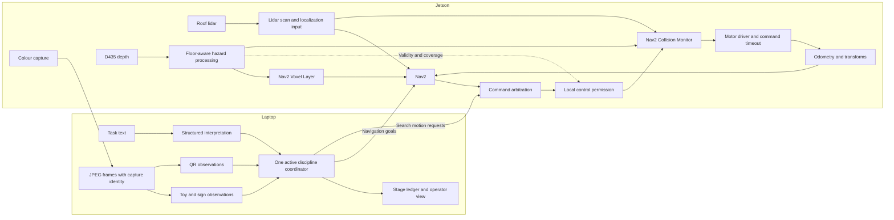

# IJKbot preparation for the RTK Cup final

* **Author:** traptron
* **Status:** Proposed — all drafting sections approved by the author; predecessor reconciliation complete; final destination selected; independent design review pending; hardware measurements and City actions remain gated
* **Date:** 2026-11-16
* **Predecessor:** [Concepts brief](../concepts_brief.md)
* **Supporting review:** [Goldfish brainstorm findings](../reviews/rtk_final_2026/goldfish_review_report.md)
* **Predecessor reconciliation:** [Authoring-stage comparison](../reviews/rtk_final_2026/draft_reconciliation.md)

## Overview

Prepare IJKbot for Evacuation and City before departure on 1 December 2026. The primary objective is to complete every scoring stage of Evacuation without contact or operator intervention. The secondary objective is an explicitly chosen set of autonomous, score-bearing City actions. The applicable final rules must define the scoring conditions; a useful City points target has not yet been selected.

The team has selected its available original Jetson Nano DevKit as the target onboard computer. An external laptop is permitted according to the team's direct competition experience and remains part of the concept. The selected board has not yet been inspected or benchmarked. Its availability does not establish software compatibility or sufficient performance, and its migration must share the existing preparation budget.

Three people can work for a reported 2–3 hours per day. The planning assumption is one shared daily robot/field window, approximately 30–45 hours from 16 through 30 November if access is available every day. Individual attendance and parallel offline capacity remain unknown. Jetson access is expected during 16–22 November, with no fixed day. If access begins on 22 November, only eight full subsequent daily windows remain before departure.

The university has a complete City field with matching field and cell dimensions. This supports repeated full-route tests, but equivalent Evacuation props and bridge tests are still needed. The concept proposes preserving 26–30 November for repeated full runs, demonstrated fault fixes and recovery rehearsal; these dates are a planning target, not evidence that earlier work will fit.

The author approved the opening section, Technical Plan, Alternatives Considered and phased Detailed Implementation in chat. T1–T8, T9-B common observations, T10-A laptop PyTorch, T11-A Ultralytics YOLO11n and T12-A combined JPEG/capture context are recorded selections. The phased plan starts with evidence preparation and independent software work; physical deployment follows only after required measurements and compatible-runtime proof. Authoring-stage reconciliation found no unresolved contradiction with the predecessor when its latest explicit decisions are applied. Independent review of this design has not yet run. No production change or deployment is authorized by this document alone.

## The Problem

In previous Evacuation attempts, the robot interpreted target cells and reached them. Victim detection was not implemented. QR reading sometimes worked outside the field, but failed during competition runs. The historical failure boundary is unknown: image acquisition, visibility, decoding, transport and mission acceptance have not been distinguished with recorded evidence.

The robot also hit toy cars approximately 4 cm high while following a Nav2 goal. At that time the D435 supplied only a narrow depth slice as a substitute for a lidar. A physical 2D lidar was added later. Seeing an object in a colour image does not establish that navigation receives useful obstacle measurements or stops in time. The roof-lidar mounting is constrained by the team's reported bridge geometry, so simply lowering it is not an established solution.

The target is a small toy person, with an unobstructed QR banner approximately 10–15 cm above the floor. The QR square may be 5 × 5 cm; this remains an estimate. The preparation must use representative props rather than treating success on unrelated people or a convenient desktop QR as proof of field performance.

The team confirms that the intended competition scene contains exactly one toy victim and one QR banner, positioned next to each other as the single target pair. This field constraint supplies their physical association; multi-target selection, figure/banner pairing among several objects and cross-target identity tracking are outside this preparation scope. Figure detection and QR information still require separate stage evidence and valid attempt/capture context. They may be obtained from different verified views of the single pair.

Local source review adds integration risks. The inspected Nav2 configuration consumes the lidar scan without an established camera-depth obstacle input. Search turns use a separate command path from Nav2 obstacle checking. QR success can mark a victim found, and returning home after an unsuccessful search can still log successful evacuation. These findings concern the checkout, not a proven reconstruction of the failed competition deployment. They mean that existing completion messages cannot be the sole evidence of readiness.

City currently has documented sign recognition and operator-directed navigation, rather than a demonstrated autonomous mission. Shared field dimensions do not supply the missing discipline behavior. Equal effort on both disciplines would compete with the team's explicit Evacuation priority and limited shared robot time.

The design must therefore establish complete sensing-to-motion behavior, independently supported mission outcomes, and repeatable trials, while accounting for the selected Jetson migration. Improving individual component demonstrations will not by itself satisfy these needs.

## Goals

| Goal | Required evidence |
| --- | --- |
| Complete the Evacuation mission | One autonomous attempt interprets the task, finds the actual victim, obtains and processes its QR information, satisfies the applicable location/hold requirements and returns to the required collection cell within the applicable time. Each stage has its own evidence |
| Avoid the known low-obstacle hazard | Representative 4 cm cars and other relevant obstacles cause timely avoidance or a safe stop during route following, search turns, approach, recovery and return. Tests cover the chassis sweep and relevant bridge transitions. Safe stopping is an intermediate safety result; complete-route success also requires reaching the mission outcome |
| Establish field-capable perception | Test the actual or equivalent toy figure/banner at measured sizes, relevant viewing angles, distances and lighting. Separate candidate observations, sufficient victim evidence, decoded QR content and mission acceptance. The final rules determine what evidence confirms the victim |
| Produce truthful partial and final outcomes | No-victim return, unreadable QR, timeout, stale/wrong-view results and interrupted attempts remain identifiable incomplete outcomes. Returning home alone must not manufacture a claim of evacuation success |
| Demonstrate the selected onboard platform | On the actual Jetson unit, establish the required software/device operation and sustained full-workload performance before accepting the installation for physical autonomous trials. Measure observation age, control delay and stopping response, as well as compute resources |
| Establish a bounded City result | Choose a numerical target or explicit score-bearing action set from the applicable rules, demonstrate it autonomously on the university field, and repeat the Evacuation regression after switching back. The action set and effort allocation remain pending decisions |
| Make preparation reproducible for three people | Each trial identifies its software/configuration and mounting, records stage evidence and failures, and supports start, stop, reset and restoration by another teammate. Failed-run evidence must be sufficient to identify the failing boundary |
| Demonstrate repeatability before departure | Run complete timed trials with changed target/obstacle placement, no contact and no intervention. The predecessor proposes five consecutive successful Evacuation trials as a practical engineering milestone; confirm this threshold in the verification design. It is not statistical proof or a guarantee of awarded points |

Existing repository constraints apply throughout the design: motor mock mode for development; braking after command loss beyond the 200 ms timeout; competition linear speed at most 0.25 m/s; the required obstacle clearance; and no raw point-cloud or uncompressed video transmission over Wi-Fi. A motor watchdog does not itself establish obstacle avoidance. Physical stopping distance and sensor coverage must be demonstrated together.

The older Izhevsk task is supporting context for the full-mission objective, including separate scoring stages and a five-second hold. It does not establish the final's exact points, time, intervention rules or accepted victim evidence. External-laptop permission is already accepted from the team and is not reopened by this rules check.

## Non-Goals

* Guaranteeing maximum points or Jetson capacity from the plan, board name, or individual successful demonstrations.
* Returning to a Pi-first target without a new team decision. The existing Pi installation is a recoverable reference, with known limitations, while Jetson is prepared.
* Moving every perception or language-model task onboard solely because Jetson has a GPU. Detailed placement remains part of the technical design, informed by the predecessor's laptop arrangement.
* Replacing the whole navigation stack, rebuilding the whole chassis, adding every available sensor, or creating a general mission framework without a demonstrated requirement. Necessary mechanical and sensor changes remain in scope.
* Assuming that a QR banner alone confirms the victim, or committing to a particular toy-person detector before selecting sufficient evidence and testing representative inputs.
* Developing both disciplines to equal scope or spending the protected full-run reserve on optional features. Any change to that allocation requires an explicit schedule decision.
* Adding a physical victim gripper under the available task description, which does not require physical pickup. Revisit only if the applicable final rules introduce that requirement.
* Rebuilding the web interface as a prerequisite for field testing when existing controls and a short operator procedure can supply the required visibility.

## Open Questions

These items are retained for later sections and physical checks. They do not require another initial brainstorming round.

* **Jetson deployment:** Exact unit/RAM, installed JetPack/OS, storage, regulated power, cooling and a demonstrated ROS/device software route. No OS image, ROS migration or container approach has been selected.
* **Physical sensing:** Actual D435 mounting and calibration, usable low-obstacle coverage, close/turning blind areas, bridge geometry and the mechanical reason for the lidar-height constraint.
* **Mission evidence:** Final judging conditions for finding the victim, reading/processing QR, hold location/duration, return and intervention; sufficient separate victim evidence; actual banner/figure samples.
* **City acceptance:** The score-bearing autonomous action set, numerical target and affordable effort cap. The brief's three-hour City-specific robot allocation is a proposal, not demonstrated feasibility.
* **Selected responsibilities, pending verification:** T1-A assigns final obstacle checking to Collision Monitor, T3-B selects typed correlated observations, and T8-B selects known safe viewpoints. Exact message layouts, timing and validated pose/coverage data remain to be completed; rejected observations must stay diagnosable.
* **Measured limits:** End-to-end latency, sustained resource load, stopping distance, sensor-loss behavior and suitable trial thresholds. No successful hardware result is assumed.
* **Capacity and dates:** Actual attendance and daily access; named workstream/integration owners; and whether the proposed 20 November migration checkpoint, 25 November major-change cutoff and final trial reserve remain feasible when Jetson arrives.

## Critical User Journeys (CUJs)

### CUJ 1: Complete an Evacuation attempt

* **Given:** The selected onboard installation has passed device and motion checks; the tested configuration, map, mounting and current mission are identified; representative obstacles and a victim/banner are present.
* **When:** The operator enters the task, checks readiness and starts the mission.
* **Then:** The robot interprets the task, navigates to the search area, obtains sufficient victim evidence, reads the relevant QR, satisfies the applicable hold and returns. The record supports each completed stage independently, including actual motion, time, contacts and intervention. A partial attempt remains partial.

### CUJ 2: Detect a low obstacle during search or navigation

* **Given:** A representative 4 cm object lies in the collision-relevant area and current sensing covers the intended motion.
* **When:** Navigation, search, approach, recovery or return requests motion toward it or sweeps the chassis toward it.
* **Then:** The final local motion check limits or blocks the command in time to avoid contact. Navigation may select a verified alternative route. Missing/stale required sensing cannot authorize continued motion; a stopped robot is not recorded as having completed its route.

### CUJ 3: Explain a failed QR attempt and restart

* **Given:** A mission/view identity and captured-input evidence exist for the attempt.
* **When:** QR is unreadable, arrives after a view changes, or a previous attempt's result is received.
* **Then:** The operator can identify the last successful boundary and the rejection/failure reason. Obsolete results cannot advance the mission. A bounded retry or incomplete outcome follows the agreed policy; reset creates a new attempt without carrying forward success evidence.

### CUJ 4: Switch disciplines without changing the tested motion path

* **Given:** A selected City action set and the Evacuation regression are defined.
* **When:** The operator stops the current mission and starts the other discipline through its documented entry point.
* **Then:** Only one discipline commander is active, both use the same tested device/navigation/protection interfaces, and switching back reproduces the Evacuation configuration without manual repair.

## Technical Plan (Architecture)

### Scope and decision state

The author approved this architecture section in chat ("согласуем"). This approval covers responsibilities, selected approaches and evidence requirements, not implementation readiness or measured capacity. The author selected T1-A, Nav2 Collision Monitor; T2-A, filtered 3D obstacle points with a Voxel Layer; T3-B, project-specific typed ROS observation interfaces; T4-A, bounded QR retries from different safe viewpoints; T5-A, adapting a compact detector to representative toy victims; T6-B, a bounded autonomous subset of City actions; T7-A, local support-surface estimation from current depth; and T8-B, known safe observation poses selected with visual bearing. Final City rules are not yet available: its actual actions are deferred without inventing scores or blocking Evacuation design. Physical/deployment prerequisites and numerical limits remain open.

The selected onboard target is original Jetson Nano DevKit. The initial target distribution remains local devices, odometry, navigation, depth-hazard processing and motion protection on Jetson, with language-model interpretation, toy/sign recognition, QR decoding and the operator interface on the laptop. This distribution follows the predecessor; it is not a measured capacity result. Preserve the working Pi installation during preparation.

### Deployment prerequisite

Before selecting an install recipe, inspect the actual Jetson model, RAM, OS/JetPack, storage, power and cooling. Demonstrate the required ROS processes, serial/USB access, D435 capture and robot/laptop message exchange with mocked motors. A container, source build or changed ROS distribution is not presumed compatible merely because it starts. Any such route must state driver/GPU restrictions, supported nodes and repeatable deployment steps before physical migration.

The [recorded platform sources and Pi inventory](../reviews/rtk_final_2026/platform_decision.md) explain the original Nano/Jazzy compatibility gap. No ROS downgrade or alternative OS is selected here. If no viable route fits the preparation window, bring the failed prerequisite and remaining hours to the author for a platform/scope decision; do not silently replace the selected board or consume the final test reserve.

### Logical data and command paths

This diagram specifies responsibilities, not yet new topic names or exact observation message layouts. T1-A selects Collision Monitor after the permission guard. T2-A supplies filtered 3D obstacle points to a Voxel Layer and directly to the monitor, without routing final obstacle checking through the costmap. T3-B selects generated ROS observation interfaces between perception and the coordinator.

Wi-Fi carries the permitted compressed colour stream, goals, observations and bounded status/evidence. Raw depth and point clouds remain local to the onboard computer. A live colour preview is not a valid substitute for current depth or lidar observations in the protection path. Recording is subject to a measured bandwidth/storage/load budget.

### Physical coverage and low-obstacle input

Retain the installed lidar scan for existing consumers; do not replace `/scan` with camera-derived data to make obstacles appear. The existing camera launch publishes `/depth/scan` from a narrow strip; the selected design must observe the collision-relevant volume, not merely reconnect that strip.

Measure camera height, pitch, near range and valid-depth coverage using actual/equivalent cars. Measure the full chassis footprint and its swept area when turning. Test bridge approach, crest and exit. A fixed height threshold on level ground is not sufficient evidence of ground/bridge discrimination. Unknown depth or an unobserved region must not be reported as measured free space.

Hazard processing must provide both usable obstacle evidence and explicit freshness/validity. Navigation uses filtered PointCloud2 through a Voxel Layer for route avoidance; Collision Monitor also receives filtered points for final obstacle checking. T2-A is selected below. This does not remove the need for measured ground/bridge treatment, usable depth and correct transforms. No dense coloured point-cloud pipeline or custom terrain mapper is committed here.

A failed or unobserved required region blocks the affected motion. Brief occlusion, sensor loss and clearing policy must not erase a previously observed car just because the camera turned away. The subsequent design must state which observations can clear occupied space and when another safe viewpoint is required.

#### T2 — Selected: filtered 3D obstacle points with Voxel Layer

**Author decision:** T2-A selected in chat ("А"). T2-B is retained as a considered option. The selected path uses the relevant depth area, retains obstacle height and preserves the roof lidar independently. Floor/bridge filtering still needs measured design; selecting 3D representation does not select or validate that algorithm.

| Option | Mechanism | Trade-offs | Conditions under which it fails |
| --- | --- | --- | --- |
| T2-A: Filtered 3D obstacle points with Voxel Layer | Transform valid depth into a common frame; identify traversable support surface; retain non-ground obstacle points with their height. Feed local filtered PointCloud2 observations to a Nav2 Voxel Layer and Collision Monitor. Keep the independently configured lidar input | Retains vertical evidence for diagnostics and uses an existing 3D occupancy mechanism; requires cloud processing, ground handling, voxel sizing and a verified clearing strategy. No GPU acceleration is assumed | Noise or support-surface estimation removes 4 cm cars or marks the bridge as blocked; height/voxel/point thresholds suppress small returns; missing valid-depth coverage or excessive processing delay defeats timely response |
| T2-B: Ground-filtered depth projected to an obstacle scan | After interpreting the relevant depth area and removing verified traversable surface, project remaining collision-relevant returns into a separate planar LaserScan. Feed that scan to the existing 2D Obstacle Layer and Collision Monitor; do not replace `/scan` | Downstream consumers handle a compact scan and reuse existing 2D navigation interfaces; projection/filtering and validity handling are team-owned. Height information is discarded from the published obstacle scan, while local diagnostic depth can be retained. Processing cost must still be measured | Projection hides required returns, declares unobserved directions free or clears an obstacle incorrectly; ground treatment fails at bridge transitions; unobserved near/side regions or processing delay defeats safe response |

The official [Jazzy Voxel Layer](https://docs.nav2.org/jazzy/configuration_and_development/configuration_guide/core_servers/costmap_2d/costmap_plugins/voxel/) represents 3D observations and projects occupancy into 2D planning. The [Obstacle Layer](https://docs.nav2.org/jazzy/configuration_and_development/configuration_guide/core_servers/costmap_2d/costmap_plugins/obstacle/) accepts scan or cloud observations into a 2D model. These capabilities establish the candidate interfaces, not automatic ground removal, bridge traversal or a throughput guarantee. Collision Monitor supports the corresponding scan/cloud source types as documented in T1.

For T2-A, a cloud containing only filtered obstacle returns cannot by itself justify clearing every removed ground ray. For T2-B, an empty angular bin does not prove free space. The chosen implementation must distinguish valid observed-free space from missing/invalid/occluded data; clearing cannot infer that distinction from absence alone.

For the selected T2-A, record the source acquisition stamp and coordinate frame on processed points. Keep the input transform, ground evidence, remaining obstacle returns and validity/coverage diagnosis traceable for each test. Select voxel size, height limits and point-count thresholds using recorded cars and bridge transitions; a nominal 4 cm target must not disappear through decimation, ground tolerance or an occupancy threshold. Retain local unfiltered evidence for diagnosis within the recording budget. Do not copy centimetre thresholds from an example configuration or claim the GPU accelerates an unmeasured processing path.

Use representative recordings to measure each selected filter's preservation of 4 cm objects, floor/bridge errors, coverage and timing. Then validate the same configuration physically under the full workload. Fresh messages containing empty or invalid measurements must not satisfy readiness merely by arriving: validity must also block motion through the onboard permission path. Source timeout alone detects missing messages, not every perception failure.

#### T7 — Selected: estimate connected support surfaces from current depth

**Author decision:** T7-A selected in chat ("А"). T7-B remains a considered option. The selected method estimates local observed support; it does not authorize a surface based on a static bridge mask or bypass obstacle checking.

The selected 3D representation does not itself classify ground or prove traversability. The current URDF supplies fixed sensor/body geometry, not a measured dynamic chassis inclination over the bridge. Neither option may assume a gravity/tilt measurement or map accuracy that the actual robot does not supply. Estimate or otherwise establish the necessary sensor/support-surface relation and test it on approach, crest and exit. Physical traction, clearance, bridge edge and slope limits must be established independently of whether a surface looks smooth.

| Option | Mechanism | Trade-offs | Conditions under which it fails |
| --- | --- | --- | --- |
| T7-A: Estimate connected support surfaces from current depth | Segment locally observed planes/smooth regions, identify the support connected to the robot's current traversable region, and admit connected ramp/deck transitions only within measured mechanical and observation limits. Retain protrusions and guardrails as obstacles; use separate connected regions rather than a single largest-plane deletion | Adapts to currently observed floor/ramp geometry without requiring an exact 3D bridge map; needs bounded local surface estimation, continuity checks, sensor/tilt handling, confidence rejection and workload validation | Small cars or unrelated horizontal tops merge into the support; gaps/edges are mistaken for connected ground; insufficient depth or incorrect inclination hides a step; estimate is unstable or too slow at bridge transitions |
| T7-B: Measured support-surface model with live verification | Prepare a calibrated floor/bridge geometry model for the known field; match current depth and robot pose/inclination to the expected local surface. Remove only observed returns that agree within validated tolerances. Leave other objects and mismatches as hazards/unknown | Uses known bridge geometry to constrain surface interpretation; adds a 3D surface/map artifact, survey/calibration, localization/inclination requirements and model validation when the field changes | Map or pose error is comparable to small-obstacle height; bridge geometry/layout differs; sensor/body inclination is wrong; a model mask deletes a real car; live verification is absent or waived |

The selected T7-A needs bridge dimensions and representative depth recordings before numerical slope, height, continuity or fit thresholds can be approved. It must not classify every fitted plane as ground or erase a car on the ramp/deck to obtain a navigable path. T7-B is retained only as an alternative and would not authorize switching off sensing or Collision Monitor either.

Existing mechanisms for candidate T7-A surface extraction include [PCL organized multi-plane segmentation](https://pointclouds.org/documentation/classpcl_1_1_organized_multi_plane_segmentation.html) and [PCL ground-surface comparison](https://pointclouds.org/documentation/classpcl_1_1_ground_plane_comparator.html). They supply geometric operations, not a complete tested bridge/4 cm obstacle solution. The current documentation is not evidence that a particular PCL build/version is available on the arriving Nano; dependency selection and timing need a target check. A map-conditioned T7-B still needs live geometric checks and has no demonstrated implementation in this checkout.

Both candidates must expose observed support, obstacle residuals, unknown regions and validity with acquisition identity. Validate an empty floor, a 4 cm car on floor, bridge approach/crest/exit, a car on ramp/deck, guardrails, an unsupported edge/gap, invalid depth and a changed sensor tilt. If a region cannot be distinguished reliably, stop affected motion and report the failure; do not increase tolerance until the car disappears. Choose the permissible operating envelope from the results, not from nominal camera visibility.

The selected local pipeline must preserve these boundaries:

1. Validate acquisition, calibration and transforms before geometric interpretation. Classify missing/invalid samples as unknown; preserve organized pixel correspondence where needed by the selected segmentation implementation.
2. Estimate candidate connected surfaces using bounded regions and normal/height/continuity checks. Establish which observed support is relevant to the robot; do not assume the largest plane is floor or that a car roof is traversable.
3. Admit a ramp/deck connection only inside the mechanically demonstrated slope/step/width envelope, with enough observed support and usable edge/obstacle coverage. A smooth-looking surface alone does not prove traction, clearance or support for the chassis.
4. Retain protrusions relative to the local support, guardrails and uncertain regions. Test that 4 cm objects survive sampling, surface-fit tolerance, residual filtering and voxel insertion on both floor and bridge. If evidence is insufficient, inhibit the affected motion.
5. Send obstacle points with capture stamp/frame to the chosen consumers; expose support/unknown/coverage health separately for readiness and recordings. Use verified free-space evidence for clearing; filtering ground out of an obstacle-only cloud does not manufacture clearing rays.
6. Measure all stages on the actual onboard environment with navigation and camera traffic active. Select/pin segmentation dependencies and numerical limits only after this experiment; no particular PCL release or GPU path is approved by the family-level choice.

### Motion ownership and protection invariant

Existing inputs include `/cmd_vel_nav`, `/cmd_vel_sm`, `/cmd_vel_joy` and emergency zero commands. The inspected robot launch routes the arbiter to `/cmd_vel_mux`, and `robot_monitor.py` can forward that to `/cmd_vel`; other launches can also create arbiters publishing directly to `/cmd_vel`. The final configuration must select one arrangement and remove competing paths from that launch, rather than start another protection node beside an unguarded publisher.

Every nonzero actuator command must pass both current control permission and current obstacle checks after source arbitration and any smoothing. Neither check may restore a velocity rejected by the other. Emergency sources may request zero; they must not form an alternative nonzero path. The driver retains its command-loss braking, mock mode and fault latching. Loss of a protection process must allow the driver timeout to stop motion rather than keep replaying an old command as fresh.

Set protection zones and validity timeouts from measured sensing coverage, total reaction delay, braking distance and turning sweep, preserving the repository's speed and clearance limits. Define actual capture-age checks in addition to message-arrival freshness; repeatedly publishing old images/hazards must not make them valid. No timeout value is approved in this section.

#### T1 — Selected: Nav2 Collision Monitor on the final command path

**Author decision:** T1-A selected in chat ("А"). T1-B is retained below as a considered option, not the active implementation. Both options were presented without a default; the selected design preserves control permission, emergency stop, the driver timeout and the common motion invariant above.

| Option | Mechanism | Trade-offs | Conditions under which it fails |
| --- | --- | --- | --- |
| T1-A: Nav2 Collision Monitor | Keep the existing permission guard, but route its output through a separately configured Collision Monitor as the last velocity processor. All nonzero command sources feed this chain. Only the final monitor publishes nonzero actuator commands | Reuses an existing component and its sensor/zone logic; adds lifecycle/configuration and requires remapping existing publishers, checking data representation and installed-version behavior | An unguarded publisher remains; required low objects are filtered out; stale captures are republished as new; zones or driver braking do not cover actual stopping/sweep; the selected Nano software route cannot run it |
| T1-B: Extend the onboard guard | Extend the current onboard command-forwarding boundary to combine permission, hazard freshness, obstacle-zone checks and stop reasons, using one final command output | Fewer separate runtime components and direct integration with current guard state; team owns geometry, timing, concurrency, reset semantics and test coverage of new motion-related logic | Custom checks miss turning/near-field cases, stale inputs or braking delay; added processing blocks stop/forwarding; permission and obstacle state interact incorrectly; implementation/verification exceeds the available time |

The official Jazzy [Collision Monitor tutorial](https://docs.nav2.org/jazzy/tutorials/general_tutorials/using_collision_monitor/using_collision_monitor/) requires the monitor to be the final velocity processor. The [parameter documentation](https://docs.nav2.org/jazzy/configuration_and_development/configuration_guide/core_servers/collision_monitor/configuring_collision_monitor_node/) describes sensor inputs, stop zones and source-timeout behavior. This establishes an available mechanism, not safe defaults for this robot or guaranteed compatibility on original Nano. In particular, default height limits must not be assumed to include a 4 cm object.

The selected nonzero command path is navigation/search/manual command arbitration, then the existing permission guard, then Collision Monitor, then the motor driver. The guard's direct `/cmd_vel` output, including timer-generated zeros, must be remapped into the monitor's input path in this configuration. Remove competing direct actuator publishers from the selected launch; do not leave the old chain running beside the new one. Emergency zero requests remain effective through the chain, and loss of forwarding/monitor activity must lead to the driver's timeout braking. The installed monitor's behavior on stale command input, lifecycle loss and sensor loss must be verified rather than presumed.

Autonomous competition also requires a current mission-owner lease, enforced onboard at the permission boundary in `robot_monitor.py` independently of the existing web-control lease. Bind permission to the active coordinator session, mission and attempt. Only advancing owner updates emitted by the coordinator's mission-control loop may refresh its local monotonic deadline; fresh Nav2 commands, sensor traffic or web heartbeats cannot renew it. Measure and record the permitted owner-update age and stop-response bound in the accepted profile. Missing verified limits or a missing owner prevents autonomous readiness.

On owner expiry or invalidation, latch nonzero-motion inhibition in that common command path, record the owner-loss stop locally and request cancellation of onboard navigation work. Stopping must not depend on cancellation succeeding. Retire the expired owner context so delayed updates cannot restore permission. Reconnection or coordinator restart cannot resume the old attempt automatically: explicit stopped-state recovery must confirm cancellation/retirement of old work, establish a new attempt and owner session, and admit only newly authorized navigation work. Preserve the incomplete outcome and existing emergency/permission behavior; no new bypass publisher is introduced. The detailed contract, task list and tests must be aligned with this policy before implementation readiness is accepted.

Mock/replay tests first inject obstacles, sensor loss, stale data, competing commands and process failure. Also kill, stall or partition only the mission coordinator while onboard Nav2, sensors and protection remain healthy; verify the measured owner-loss stop bound, cancellation failure, delayed updates and restart/reconnect without stale-goal resumption. Controlled physical trials then measure response for navigation, search turns, approach, recovery and return. Watching the robot stop once is insufficient to accept the wiring.

### Observation acceptance and mission outcomes

The existing readers and sign outputs are reuse candidates, not authoritative scoring decisions. Define a bounded observation lifecycle: request/view context; captured input; perception result; mission acceptance or rejection; evidence reference. Required information includes mission/attempt/view identity, source capture identity/time, observation kind and payload, and validity/rejection reason. T3-B selects project-specific ROS interfaces below; plain text without context is insufficient as the sole mission acceptance contract.

#### T3 — Selected: project-specific typed ROS observation interfaces

**Author decision:** T3-B selected in chat ("Б"). T3-A remains a considered option. The local native QR reader publishes plain text and Boolean detections. The mission consumes those without shared acquisition/view metadata; existing City sign outputs instead use JSON strings. The C++ vision package currently depends on standard ROS messages and OpenCV, with no project-specific interface package. The selected change requires coordinated producer/consumer deployment and generated interfaces on the participating hosts.

| Option | Mechanism | Trade-offs | Conditions under which it fails |
| --- | --- | --- | --- |
| T3-A: Versioned JSON in standard String messages | Define a bounded versioned observation envelope inside `std_msgs/String`; validate at Python boundaries with Pydantic and explicitly validate serialization/fields at C++ producers. Use the same documented envelope in recordings | Reuses standard message transport and the existing City JSON pattern; does not need generated project message bindings. Adds an explicit JSON/schema dependency and field validation in every implementation; ROS tooling sees a string rather than typed fields | Incompatible schema versions or missing IDs are accepted; C++ and Python disagree on validation/escaping/types; oversized payload or malformed input blocks processing; coordinated schema/producer changes are skipped |
| T3-B: Project-specific typed ROS interfaces | Add a small interface package with generated request/observation types carrying the agreed metadata and typed payload fields; make perception and mission packages depend on the same interface revision | Gives explicit generated fields in C++/Python and structured ROS inspection; adds an interface package, build/dependency changes and deployment coordination across hosts. Runtime checks of freshness/identity and payload semantics are still required | Hosts use mismatched interface revisions; bindings are absent on the chosen Jetson environment; unbounded fields or weak semantic validation admit invalid observations; integration exceeds the time budget |

Add a small interface-only ROS package named `ijkbot_interfaces` in the later implementation. This is a proposed new package, not an existing artifact or a package created during drafting. It contains message definitions and generated language bindings; it must not depend on detector implementations, the dashboard or mission logic. Update the participating `brain`, `vision` and `vision_cpp` dependency/build declarations together. Deploy matching definitions and verify C++ producer to Python consumer exchange in both mock and target environments before changing mission authority.

The typed contract must express these information groups; exact message layouts, field bounds and topic/QoS declarations will be completed in Detailed Implementation:

| Information | Required meaning and validation |
| --- | --- |
| Mission, attempt, request/view and observation identity | Coordinator-issued current context for requested work; producer-issued unique observation identity. Missing or mismatched context cannot advance the mission; resetting creates a new attempt |
| Capture provenance | Original camera stream/session identity, source frame identity, acquisition stamp and frame name. Decoder finish/receipt time must remain distinct; an old frame cannot inherit a new request's identity |
| Observation kind and processing outcome | Distinguish candidate, sufficient victim evidence, decoded QR, sign observation, no result and processing/input failure. Invalid combinations are rejected explicitly |
| Bounded typed payload | Appropriate QR text, candidate/sign data and image coordinates as applicable. Confidence, coordinate bounds and payload-size checks remain necessary despite generated fields |
| Evidence association | Run-relative evidence/capture reference, not an arbitrary remote filesystem instruction. Missing evidence is diagnosable; large image bytes are carried separately under the existing transport limits |
| Acceptance/rejection record | Coordinator-generated decision and reason tied to the received observation. Perception cannot mark itself accepted or complete a scoring stage |

The contract carries metadata and compact perception results, not raw images or point clouds. Preserve original QR content exactly, including Cyrillic and line breaks, within a declared tested size bound. Oversized content is an explicit failure, never a silently truncated success. Image evidence is referenced by capture/evidence identity rather than embedded as base64 in an observation. Confidence and bounding boxes, where present, describe a candidate and do not themselves authorize a scoring transition.

The coordinator supplies mission/attempt/view identity for requested observations. A producer must not relabel a pre-existing captured frame as the current request. Continuous detections can be diagnostic candidates until associated with a relevant view and valid acquisition. Retain original source stamps, check host clock assumptions and use local monotonic clocks for local deadlines; a later decode timestamp is not a replacement for acquisition time. Reset makes earlier attempt IDs ineligible. Generated message types do not prove freshness, semantic validity or host-clock agreement. The detailed schema, QoS and deadline values will follow the selected transport and measured processing times.

Contract verification includes malformed/invalid field combinations, wrong or reset attempts, duplicate observations, delayed processing after a turn, camera restart with reused frame numbering, missing timestamps, host clock disagreement and loss of the producer. Correctly transport an actual representative QR payload through the native reader, typed interface, Python coordinator and exported evidence without changing its text. A replay of old latched evidence may be visible diagnostically but cannot credit a new run.

Legacy `/victim_status` text may remain available for display/compatibility, but uncorrelated legacy results cannot independently advance the new mission. Do not create an adapter that invents current view identity for old text. Reject malformed, unsupported-version, stale, wrong-attempt and duplicate results with recorded reasons; duplicate valid evidence must not create repeated mission actions.

Use one mission transition owner to accept observations and update stage outcomes. Callbacks can enqueue/report observations and update diagnostic display; they must not independently claim mission success. Reset invalidates previous mission observations. QR-only input may guide search but cannot assert victim evidence unless the agreed final judging criteria allow that meaning. Duplicate results do not repeat holds, returns or scoring events.

T5-A below selects adapting a compact toy detector, with representative figure/banner inputs and sufficient victim evidence still to be obtained. QR uses the selected existing decoder path with a single documented capture/configuration, not an accidental mixture of standalone one-shot and mission settings. Measure capture-to-acceptance time before fixing retry/dwell deadlines. A trigger must use a verified fresh frame or report failure, rather than silently decoding the last retained image.

Record interpretation, candidate, victim evidence, QR information, hold evidence, safe return and terminal outcome independently. A five-second timer while sending zero is not, by itself, proof of physical stillness in the required cell. Search exhaustion and timeout can produce a safe return while preserving incomplete stages. T4 selects behavior after confirmed victim but unreadable QR below; final scoring consequences remain subject to the applicable rules.

#### T4 — Selected: bounded QR retries from different safe viewpoints

**Author decision:** T4-A selected in chat ("А"). T4-B remains a considered option. Preserve already established victim/hold evidence, keep the QR stage incomplete until a valid result is accepted, obey the same motion protection and stop before using the reserved return time. The selected policy does not guarantee that a partial return earns evacuation points. Missing camera/invalid frames and an optically unreadable but fresh image are separately recorded failures, not indistinguishable reasons to keep turning.

| Option | Mechanism | Trade-offs | Conditions under which it fails |
| --- | --- | --- | --- |
| T4-A: Bounded retries from multiple safe viewpoints | After a failed decode, select another observation pose only if coverage/navigation permit it and the remaining retry budget leaves the measured return reserve. Stop, stabilize, capture a new identified frame and retry. Return with the truthful partial outcome if the budget is exhausted | Gives different distance/angle opportunities for a readable image; costs motion, planning, capture and more testing. Needs an explicit limit on views/time and a conservative return allowance | No safe alternate view exists; the same unreadable view is repeated; pose changes bring the target outside usable coverage; return allowance is underestimated; added movement or detection delays consume the deadline |
| T4-B: Short stationary retry budget, then return | At the confirmed safe observation pose, allow a bounded number/time of fresh captures and decode attempts without additional pose search. If still unreadable, preserve evidence and return with QR incomplete | Bounds motion and local decision complexity; can preserve more return time but leaves distance/angle-related image failures unresolved | Initial pose cannot resolve the code; repeated stationary captures do not change the failing condition; fixed retry allowance is inadequate for measured processing delay or total available time |

For the selected T4-A, set numerical view/retry/time limits from representative captures and complete-route timing, then document them before implementation. The current hard-coded 250-second return trigger and assumed 50-second return allowance are checkout behavior, not validated values for this plan. A reserve needs a measured conservative travel/replanning allowance; if no safe return path exists, stop and report that condition rather than drive through a known obstacle to meet a timer.

Each new viewpoint must be a reachable pose with verified motion/sensing coverage, not an arbitrary forward step toward the banner. Stop and establish a stable fresh view before requesting the next decode. An obstacle stop or uncertain target position is a reason to reject that viewpoint, not disable Collision Monitor. Deduplicate attempted viewpoints and stop at the agreed count/time bound. Record which view and frame produced each accepted or rejected QR result.

| Retry condition | Selected-policy behavior |
| --- | --- |
| Fresh stable image, decode failed, safe alternative exists and budget permits it | Move through the protected command path to another view, establish a new view identity and capture again |
| Fresh stable image, decode failed, no safe alternative remains | End view search, record unreadable QR and preserve completed stages; return if permitted and safely achievable |
| No fresh image or invalid observation provenance | Diagnose the capture/transport failure under a bounded recovery allowance; do not treat new robot poses as a cure for a stopped camera |
| QR accepted with valid current-view evidence | End retries and continue the remaining applicable hold/return stages once, using the original accepted text |
| Retry budget or return reserve reached | End retries and record the incomplete QR stage; initiate only the declared safe return behavior |
| Result from abandoned view/reset attempt arrives | Record rejection; do not count it for the current view or restart a completed transition |

Verification must include a code readable only from a different safe view, a permanently unreadable banner, loss of camera, a delayed valid result from an abandoned view, no alternate safe pose and return-time exhaustion. An accepted late result must never silently reverse a return or restart search; applicable acceptance/state rules must be explicit in the implementation design.

#### T5 — Selected: adapt a compact detector to representative toy victims

**Author decision:** T5-A selected in chat ("А"). T5-B remains a considered option. Run perception on the laptop, report candidates through the selected typed contract and leave acceptance to the mission coordinator. A generic real-person detector or successful QR decoding does not establish toy recognition. The QR banner can supply a search cue; banner-only scenes must remain distinguishable from a visible toy with unreadable QR.

| Option | Mechanism | Trade-offs | Conditions under which it fails |
| --- | --- | --- | --- |
| T5-A: Adapt a compact object detector to representative toys | Collect and annotate relevant toy/banner/field examples and negative scenes; adapt a pretrained detector for a separate toy-victim class. Validate on independent capture sessions and field arrangements before promoting weights and acceptance thresholds | Can use learned appearance across the represented poses/backgrounds; requires representative props, annotation, training/inference dependencies and a held-out evaluation. Laptop inference/training must be measured with its other intended workloads | Training examples do not represent the final toy; adjacent video frames leak into evaluation; the toy occupies too few usable pixels; field distractors cause false confirmation; data preparation or dependency work exceeds the budget |
| T5-B: Recognize the known toy from reference appearances | Capture the known toy from relevant views; use reference-image/feature/shape matching and geometrical consistency checks to locate candidates without detector training. Keep banner localization as an optional cue, not a prerequisite or victim proof | Avoids detector training and can build on OpenCV already used by the project; requires representative reference views, scale/pose handling, rejection thresholds and explicit checks against lookalikes. Does not establish lower total effort or better accuracy | The final toy differs from the references; small/low-texture appearance supplies insufficient features; pose, lighting, occlusion or distractors break the chosen matcher; hand-tuned rejection logic consumes the available time |

Examples of the candidate mechanisms are documented by [Ultralytics custom-data training](https://docs.ultralytics.com/modes/train/) and [OpenCV feature matching](https://docs.opencv.org/4.x/dc/dc3/tutorial_py_matcher.html). These sources establish available methods, not a model/version decision, dataset sufficiency or performance on this prop. No external images, weights or datasets have been downloaded during drafting.

Before judging either selected method, obtain actual or representative toys and record their measured image sizes at search/viewing distances. Include unreadable/covered QR with a visible figure, banner without a figure, toy without a visible banner, empty field and visually similar distractions. Separate evaluation sessions/arrangements from those used to train or tune. Record missed figures, false candidate/confirmation events, latency and the resulting mission decisions, not only model confidence.

The selected training path has the following evidence gates. They are required preparation work, not training or deployment already performed:

1. Obtain representative figures and the actual camera stream. Record approach/search views at relevant distances, orientations, illumination and backgrounds, including the permitted 640×480 compressed network input. A high-resolution training image alone does not establish performance on the transmitted stream.
2. Annotate the toy-victim class separately from the QR/banner. Include hard negative scenes such as an empty banner, cars/debris and similar objects; a model that learns only the visible QR pattern must fail evaluation when the banner is present without a figure.
3. Split recordings by physical capture session/arrangement before selecting frames or augmenting them. Hold out scenes used for final evaluation rather than adjacent frames from the same video. Record prop variations and image-size ranges represented and missing.
4. Use the selected Ultralytics YOLO11n model with native PyTorch on the laptop. Pin compatible library versions and checkpoint artifacts after a reproducible laptop compatibility check; TensorRT conversion is outside the selected baseline. Measure memory/latency with QR, preview and the intended language-model workload; do not infer capacity from the GPU model alone.
5. Adapt the detector, inspect held-out misses and false positives, and choose acceptance thresholds using measured evidence. Maintain model/dataset/configuration identities with results. Merely completing training or reaching a convenient training score is not acceptance.
6. Run the full robot search and approach sequence on changed field arrangements, including unreadable QR and banner-only negatives. Confirm that rejected detections and false candidates cannot produce a successful-victim stage. Define numeric detection and mission-level acceptance thresholds before implementation tasks are finalized.

The data/annotation/inference owner should collect and test recordings before Jetson arrives where the existing safe camera setup allows it. This work consumes the same three-person budget; it is not free parallel capacity. If representative figures or sufficient pixel detail are unavailable, report that failed prerequisite before committing further training time. Do not silently replace actual toy evidence with unrelated human datasets.

A 2D detection box is not a verified world-coordinate navigation target. T8 below selects how a candidate yields a safe search/viewing pose. Do not infer distance from confidence or assume colour and depth pixel coordinates coincide. Retain acquisition identity if a laptop detection is matched to onboard depth; no raw depth transfer is required merely to make that association.

#### T8 — Selected: known safe observation poses with visual bearing

**Author decision:** T8-B selected in chat ("Б"). T8-A remains a considered alternative. Nav2 and Collision Monitor retain feasible protected motion. Victim evidence is independent of QR decoding. A detection may prioritize an existing verified pose or guide a protected orientation change, but does not create a new forward approach distance or world-coordinate target by itself.

| Option | Mechanism | Trade-offs | Conditions under which it fails |
| --- | --- | --- | --- |
| T8-A: Match image detections to local depth and compute observation poses | Laptop sends a typed detection tied to its source camera/frame and image geometry. Onboard processing matches corresponding calibrated depth, estimates a supported target location, and supplies bounded pose candidates with standoff and QR/figure visibility checks. Navigation accepts only collision-free reachable poses | Can adapt observation distance/direction to the actual target; adds colour-depth association, calibration, bounded retained-depth state, uncertainty handling and target-to-pose logic. Raw depth/cloud remains onboard | Background points dominate a tiny toy box; depth is invalid/occluded; compression/crop coordinates or clocks are mismatched; a delayed detection refers to an evicted frame; localization/uncertainty produces an unsafe or unreadable pose |
| T8-B: Use known safe observation poses with visual bearing | Prepare a bounded set of verified search/view poses around each mapped landmark/accessible cell. Use current image bearing and actual visibility to choose/reorder those poses, without deriving a target range from the detector. At each reachable pose, orient safely and capture a new view | Avoids target-depth association and may reuse existing landmark search waypoints; requires sufficient pose coverage for varied target locations, correct map/pose and independent evidence of the required nearest cell | Available poses cannot show/read the target, a landmark has an unseen side, random placement falls outside coverage, route changes block the set, or repeated distant views consume the retry/return budget |

The current RealSense launch disables alignment and synchronization; the existing narrow-strip launch is not a completed target-localization pipeline. The official [RealSense projection documentation](https://github.com/realsenseai/librealsense/wiki/Projection-in-RealSense-SDK-2.0) describes mapping valid depth pixels to 3D using the relevant intrinsics and transforming between stream coordinate systems using extrinsics. The [ROS wrapper](https://github.com/realsenseai/realsense-ros#post-processing-filters) documents alignment/synchronization mechanisms. They establish tools, not valid depth for every toy or safe target coordinates without calibrated matching. No alignment setting is changed during this design step.

For T8-A, a point from the geometric centre of a bounding box is not automatically the toy or banner. Validate the spatial support of associated samples and return uncertainty/unavailable when background/invalid depth cannot be separated. Figure and QR banner can occupy different pixels and depths; preserve the identity of the object actually localized. If the image is resized/cropped for detection, retain the transform back to calibrated acquisition coordinates. Bind any lookup to the source frame/session, not the newest available depth. A bounded-buffer miss must produce an explicit unavailable result rather than silently use another frame.

For T8-B, do not infer that the nearest preselected cell is the nearest cell to the actual victim without sufficient evidence. The repeated QR viewpoints under T4-A must be genuinely different, safely reachable and relevant; a fixed set that repeatedly cannot read the actual banner fails the full mission goal. Neither option permits a blind forward step, steering directly from box centre alone, or continuing through a blocked pose.

The selected T8-B plan uses a measured catalogue of observation poses. Existing landmark goals in `src/brain/config/arena.json` and planning helpers in `src/brain/llm_client.py` are starting data, not certified field poses. For each catalogue entry, record map/layout identity, landmark, pose/cell, allowed viewing sector, surveyed target regions covered, visibility/readability evidence and dynamic-obstacle exclusions. Do not copy coordinates from an older field layout without verification.

The bounded runtime sequence is: select the task's landmark pose set; discard currently invalid/unreachable poses; choose an unvisited applicable view; navigate through the protected path; stop and establish the current pose/view; capture fresh images and evaluate typed observations. Use observed image bearing to prioritize remaining relevant catalogue poses or orient within the safe sector. A failed viewpoint is recorded with its reason. Deduplicate visits and return/incomplete outcomes according to T4-A when the budget or available verified views are exhausted.

Successful victim recognition requires accepted fresh figure evidence from the selected detector. A banner-only scene must not create that stage. A single confidence value does not prove enough evidence: determine temporal confirmation and negative-scene thresholds from held-out scenes and full runs, then fix them in the verification design. Keep figure and QR stage evidence separate. Under the confirmed single-pair field scope, both concern that pair and may be acquired at different verified views, provided each observation satisfies its current attempt/capture checks. A QR observation alone cannot establish the independent victim stage.

The required nearest-cell hold is a separate proof obligation. Survey which target regions/cells each known pose can actually observe, and establish whether the accepted victim observations identify a valid hold cell. If they leave several possible victim regions requiring different hold cells, obtain another verified view or record unresolved location; do not equate the robot's present cell with the required nearest cell. The detailed design must resolve this association using representative field placements before the implementation is considered ready. Choosing T8-B does not silently add T8-A depth localization as a fallback.

For a confirmed valid hold cell, record actual pose and physical stillness for the applicable hold duration; motion outside the accepted tolerance interrupts that hold evidence. Capture/decode may occur during a valid stationary hold, but a failed decode must not fabricate or erase independently valid victim/hold evidence. Any later QR retries remain restricted to the verified pose catalogue. Survey/coverage or nearest-cell ambiguity that cannot be resolved is a failed prerequisite, requiring an explicit design revision rather than fabricated success.

Validate the single figure/banner pair at varied placements across the relevant search area; a visible figure with unreadable QR; a readable QR with the figure temporarily outside the image; invalid/background depth; delayed frame results; target near an obstacle; and a safely visible target without a safe approach. Banner-only and empty-field inputs remain component-negative tests, not additional competition targets. Measure localization/view coverage and complete-run time. Exact standoff, localization uncertainty and retry-pose limits must be fixed from those tests before implementation tasks are accepted.

For the LLM, preserve structured output and validation; coordinate/map lookup belongs to program logic. The project's required contract fields are `target_landmark_id`, `search_strategy` and `reasoning`. Existing code also contains a local-object extension, so the technical design must reconcile that interface with repository instructions before changing it. No new free-text motion command path is introduced.

### City, operation and trial records

Keep discipline-specific sequencing separate. T6-B selects a bounded autonomous subset of City behavior; the applicable rules still have to establish the actual action set and its scoring criteria. Reuse the chosen navigation, sensor and protection configuration; changing discipline must not duplicate arbiters, commanders or motor drivers. Existing sign detections can feed a typed observation producer/adapter under T3-B, with genuine acquisition metadata; legacy JSON outputs may remain diagnostic but do not gain mission authority by being relabelled.

#### T6 — Selected: bounded autonomous City action set

**Author decision:** T6-B selected in chat ("Б"). Full City completion is not the required secondary scope for this preparation; T6-A remains a considered option. Evacuation retains primary priority.

The local [City guide](../GOROD.md) describes a start from an assigned corner cell, following direction/prohibition signs, two-second bus-stop holds and termination before parking. It explicitly says current navigation and stop timing are operator-controlled. The linked official PDF could not be retrieved during this drafting step, so this is project-document context, not verified final scoring. Do not attach invented points to either option below.

| Option | Mechanism and intended result | Trade-offs | Conditions under which it fails |
| --- | --- | --- | --- |
| T6-A: Target the complete autonomous City scenario | Implement separate City sequencing using current sign outputs, verified route/localization, permitted turns, required stops and the parking finish. Test changed sign/route arrangements and preserve Evacuation as the primary priority | A complete discipline result if achieved; requires route/sign association, turn decisions, dwell/finish evidence and full-route verification. It is not established to fit the predecessor's proposed three-hour City allocation; its actual budget must be resolved before commitment | City consumes primary-discipline integration/test time; route ambiguities or final rules are unresolved; sign errors trigger wrong turns; matching grid dimensions are mistaken for an implemented route controller |
| T6-B: Target a bounded autonomous subset of City actions | Select explicit actions from the applicable scoring table and implement only the autonomous route/stop/finish behavior needed for those actions. Name the selected points/action target before final implementation planning | Caps the secondary behavior/test surface and may preserve Evacuation preparation time; accepts a limited intended City result. Operator-supplied goals or isolated sign recognition are not assumed to earn points | Final rules do not award the chosen partial behavior; an omitted capability is required even for that subset; the subset has no numeric/action acceptance target or cannot be tested autonomously |

The selected bounded scope does not establish that any particular partial route earns points. The earlier three-hour City-specific allowance, 22 November Evacuation checkpoint and final-test reserve remain proposals; resolve the actual action set and budget before claiming it is scheduled. A missed milestone must be visible rather than represented as completed work.

There is no City scoring table in the inspected repository documents. The City guide supplies a behavior description and an external PDF link, but the official file could not be retrieved during this drafting step. Obtain the applicable final regulation or a verifiable organizer clarification before selecting actions; do not transfer Evacuation scores to City or guess that sign recognition/operator goals alone earn points.

**Author update:** Final City rules are not yet available. Keep T6-B as the chosen limited scope, with its specific actions/score explicitly deferred. Do not repeatedly request an unavailable document, fill the gap with an assumed scoring table or count City readiness as achieved. Continue Evacuation and shared device/navigation/protection work; revisit the action-selection table when the rules appear. City behavior remains a separate later work package whose final tasks cannot yet be approved.

For each candidate City action, the next revision must record: rule section/version; awarded score and dependencies/penalties; autonomous trigger and required completion evidence; reusable code versus missing behavior; expected robot-time cost; and the changed-placement trial that proves it. The selected subset must form a valid scored attempt under those rules, not merely a collection of individually working demonstrations. The author then selects the concrete set and target from that comparison.

Reuse the CLI, telemetry, recorder and protocol as the first evidence surface. A run identifies the code/configuration, calibration/mount, map, discipline, current observations, stage outcomes, stop reasons and intervention. Save failed and interrupted runs as well as completed ones; keep selected unsuccessful QR/depth evidence within a bounded retention budget. Actual image/event correlation and storage format remain to be specified, not a request for another observability platform.

### Existing components affected by this plan

This table identifies the current integration surfaces. It is not the exhaustive file list required by the later Detailed Implementation Plan. New file names and exact APIs follow selected architecture choices.

| Area | Existing files | Expected design impact |
| --- | --- | --- |
| New observation interfaces | Planned `src/ijkbot_interfaces/` (not yet created); dependency/build declarations in `src/brain/package.xml`, `src/vision/package.xml`, `src/vision_cpp/package.xml`, `src/vision_cpp/CMakeLists.txt` | Define and generate shared typed contracts, coordinate producer/consumer versions, and test field semantics across Python/C++ |
| Runtime selection | `config/ijk.yaml`, `tools/ijk/config.py`, `tools/ijk/profiles/competition.py`, `src/bringup/launch/system.launch.py` | Represent actual onboard target, coherent startup and one active discipline; preserve existing unrelated edits |
| Devices and depth | `src/bringup/launch/robot.launch.py`, `src/bringup/launch/realsense_laserscan.launch.py`, `src/bringup/config/realsense_laserscan.yaml`, `src/description/urdf/ijkbot.urdf.xacro` | Select camera/device roles, measured transforms and replacement/addition for narrow depth-strip handling |
| Navigation and command chain | `src/nav2/config/nav2_params.yaml`, `src/nav2/config/twist_mux.yaml`, `src/nav2/launch/navigation.launch.py`, `src/bringup/scripts/robot_monitor.py`, `src/bringup/scripts/web_guard.py` | Add selected hazard input and final protection chain without duplicate or bypass publishers; preserve guard behavior |
| Motors | `src/driver/src/diff_drive_node.cpp`, `src/driver/config/params.yaml` | Verify existing timeout, braking, fault and mock behavior against the final chain; source changes are not assumed necessary |
| Perception and mission | `src/vision_cpp/src/qr_reader.cpp`, `src/vision/vision/qr_reader_node.py`, `src/vision/launch/qr_reader.launch.py`, `src/vision/config/qr_reader.yaml`, `src/brain/mission_sm.py`, `src/brain/llm_client.py` | Choose the deployed QR path, correlate observations, separate evidence/stage transitions and reconcile the LLM contract |
| City | `src/bringup/launch/city.launch.py`, `src/vision/vision/city_sign_node.py`, `docs/GOROD.md` | Use current sign outputs in a separately defined autonomous City scenario |
| Trials and operation | `tools/ijk/runner.py`, `tools/ijk/web/telemetry.py`, `docs/WEB_CONTROL.md` and existing related tests | Extend bounded evidence collection and operator procedure; avoid UI redesign |

### Approved architectural choices

| Decision | Author selection |
| --- | --- |
| Onboard target | Original Jetson Nano DevKit, with deployment/capacity checks still required |
| T1 | A — final Nav2 Collision Monitor after arbitration and permission checks |
| T2 | A — filtered local 3D points, Voxel Layer and direct monitor input |
| T3 | B — generated project-specific ROS observation interfaces |
| T4 | A — bounded QR retries from different verified safe viewpoints |
| T5 | A — compact detector adapted to representative toy-victim images, on the laptop |
| T6 | B — limited autonomous City actions, exact selection deferred until rules appear |
| T7 | A — connected support surfaces estimated from current depth |
| T8 | B — surveyed safe observation poses, prioritized/oriented using visual bearing |

No further architecture alternative is silently selected by this revision. Section approval accepts these responsibilities and evidence gates, not unmeasured thresholds or a guarantee that the scope fits. The new interface package, trained detector and local surface estimation add work to the same 30-hour conservative baseline; choosing existing viewpoint poses reduces one localization dependency but does not demonstrate full search coverage.

### Prerequisites to close before implementation can be finalized

| Evidence needed | Proposed responsibility and next check | Failure consequence |
| --- | --- | --- |
| Nano software/device route and full workload | Platform/navigation owner, first available board session; mock devices/motors first, then actual camera/lidar and sustained-load measurements | Bring the exact failed compatibility/performance boundary and remaining time to the author; retain the Pi reference installation |
| Real mount, support surfaces, 4 cm hazard coverage and braking envelope | Navigation/geometry owner; record and replay floor/bridge/cars, then perform controlled physical response tests | Affected motion remains inhibited; numerical filters/zones cannot be declared final |
| Representative figure/banner and data quality | Perception owner; capture before board arrival where possible, annotate and separate held-out sessions | Do not substitute an unrelated human dataset or claim toy detection readiness |
| Catalogue coverage and nearest-cell evidence | Mission/test owner with the perception owner; survey actual placements, view sectors, QR readability and hold-cell association | Update/restrict the catalogue or seek an explicit revised localization design; do not invent range or nearest-cell evidence |
| Observation layouts, compatible builds and replay semantics | Interface/mission owner; define bounded messages and test Python/C++ exchange, reset, late and duplicate events | Old uncorrelated outputs remain diagnostic only; no new mission authority |
| Detection/hold/retry/timeout limits and conservative return allowance | Joint field session; measure end-to-end attempts and fix values with acceptance tests | No indefinite retry; do not use the existing 250/50-second split as measured evidence |
| Actual capacity and dates | Team's integration owner; fit acquisition, migration, model work and daily shared trials into real attendance | Reassess milestones explicitly; preserve the proposed final full-run reserve rather than count missing work as complete |
| City's allowed partial scoring | Deferred until final rules are available; mission owner then compares explicit score-bearing action sets | City implementation tasks and readiness remain deferred; shared/Evacuation work continues |

These are proposed role responsibilities, not named assignments or completed experiments. The available Jetson's arrival and City's unpublished rules are external dependencies; do not repeatedly ask for facts the team has said are unavailable. The later Detailed Implementation Plan must enumerate every file, exact interfaces and measurable verification, and must not describe these open facts as resolved. A phased investigation task can have explicit output/pass/fail conditions; later hardware-dependent implementation cannot be labelled unambiguous until its required evidence and decisions are recorded.

## Alternatives Considered

**Section approval:** The author approved this section in chat ("согласовываем") and authorized proceeding to Detailed Implementation.

These alternatives reflect the predecessor's `Alternatives Weighed` section and recorded author choices T1–T8. Author selections are identified explicitly; deferred options remain distinct from rejected ones.

### 1. Retain Raspberry Pi as the primary onboard target

* **Pros:** Preserves the existing Ubuntu/Jazzy installation, device setup and a previously point-scoring navigation arrangement; avoids board migration work.
* **Cons:** Capacity for the added depth/surface processing is unmeasured. The current sensing/motion integration still has known gaps. Remaining on Pi does not itself solve them.
* **Author decision:** the author explicitly chose the available Jetson Nano as the target and approved that architecture. This supersedes the brainstorm's Pi-first recommendation. It is a platform preference, not evidence that the inspected 4 GB Pi failed a workload test or that Nano is a drop-in upgrade.
* **Condition for reconsideration:** A demonstrated Nano compatibility/capacity problem and an explicit author decision, with a measured viable alternative. Preserve the Pi reference installation, but do not call its current configuration a safe competition fallback.

### 2. Continue using only a narrow depth strip or simply reconnect `/depth/scan`

* **Pros:** Reuses the existing camera-to-scan node and familiar scan inputs with limited integration changes.
* **Cons:** A narrow strip does not establish visibility of 4 cm cars or coverage of the chassis sweep. Reconnecting it cannot supply geometry that it never measures. The team's previous collision occurred with narrow-strip sensing, although its exact deployed failure path is not reconstructed.
* **Reason not selected:** The approved T2-A/T7-A design requires volume evidence, ground/support interpretation and preservation of low obstacles. A strip-only path does not meet that evidence requirement by configuration alone.
* **Condition for reconsideration:** Only for a separately demonstrated limited use or diagnostic role. It cannot replace required collision-volume coverage without new evidence and author agreement.

### 3. Lower the roof lidar or rely on added ultrasonic sensors

* **Pros:** A different scan height or complementary range sensors may observe a measured blind region without the selected depth-processing load.
* **Cons:** The team reports bridge constraints on lowering the lidar. Ultrasonic models, mounting, detection coverage and failure behavior have not been established. Neither option proves whole-chassis protection or useful obstacle mapping merely because the hardware is available.
* **Disposition:** **Deferred, not technically rejected by the author.** The selected baseline retains the roof lidar and develops depth-derived hazard coverage. Mechanical/sensor additions remain valid responses to a measured residual gap; no unverified parts are included as required dependencies.
* **Condition for reconsideration:** A named blind area, proven repeatable response to actual cars and a mounting/integration/test cost that fits the remaining time.

### 4. Put obstacle geometry checks inside the existing onboard guard

* **Pros:** Could combine permission and obstacle decisions in one runtime boundary with fewer separately launched components.
* **Cons:** The team would own new geometry, freshness, command timing, concurrency and failure/reset behavior in motion-related code. This increases implementation and verification work at a short deadline.
* **Author decision:** T1-A, the existing Nav2 Collision Monitor, was selected over T1-B. The recorded technical trade-off favors using its established sensor/zone mechanism while keeping permission checks before it; it still requires complete command remapping and measured settings.
* **Condition for reconsideration:** The selected monitor cannot meet a demonstrated required behavior or run in the verified deployment route, and the author accepts the bounded implementation and test cost of another solution.

### 5. Collapse ground-filtered depth into a planar obstacle scan

* **Pros:** Compact downstream data and reuse of the existing 2D obstacle/scan interfaces after ground treatment.
* **Cons:** Loses height information and requires correct projection, unknown-space and clearing semantics. It still needs ground/bridge handling and valid close-range measurements; it is not the old narrow-strip pipeline made safe automatically.
* **Author decision:** T2-A retains filtered 3D returns with Voxel Layer and direct Collision Monitor input instead of T2-B. That preserves vertical diagnostic evidence at the cost of local cloud/voxel processing.
* **Condition for reconsideration:** Measured target-load problems or a validated compact projection that preserves required small-obstacle evidence, clearing semantics and stopping response, followed by an author decision.

### 6. Carry versioned JSON observations in standard String messages

* **Pros:** Reuses existing standard message transport and the City's JSON pattern; avoids a generated interface package.
* **Cons:** Requires consistent explicit JSON/schema validation across C++/Python, with weaker typed inspection by ROS tools. JSON alone does not solve frame association, reset or late-result behavior.
* **Author decision:** T3-B introduces generated project-specific ROS interfaces instead of T3-A. The selected trade-off accepts interface-package/build coordination for explicit shared fields. Runtime semantic validation remains required.
* **Condition for reconsideration:** A demonstrated binding/deployment restriction on the actual environment, or changed integration cost, with an explicit author decision and no loss of correlation/validity requirements.

### 7. Use QR success as the sole victim-found signal

* **Pros:** Reuses existing QR detection and the current mission shortcut, avoiding a separate figure-recognition task.
* **Cons:** Makes unreadable QR prevent independent victim evidence and can make a banner-only scene appear to contain a victim. It also obscures which scoring stage actually succeeded.
* **Reason not selected:** The approved mission separates figure evidence, QR information and terminal outcome, and T5-A supplies independent toy recognition. The final judging requirements remain to be confirmed; this design does not invent a rule that any banner proves a victim.
* **Condition for reconsideration:** Explicit applicable judging criteria accepting another sufficient observable signal, followed by an author-approved simplification. A working decoder alone is not that clarification.

### 8. Recognize the toy using reference images instead of adapting a detector

* **Pros:** Avoids detector training and can use OpenCV already present in the project.
* **Cons:** Depends on representative reference views and sufficient image detail/features, with scale, pose, light and lookalike rejection work. It does not establish lower total engineering effort.
* **Author decision:** T5-A, adapting a compact detector to representative toys, was selected over T5-B. The selected path represents appearance variation through training data, accepting capture/annotation, runtime and independent evaluation costs.
* **Condition for reconsideration:** Required data/training compatibility cannot be obtained in time, and a reference method passes the same held-out/field tests with an author-approved scope change. An unrelated generic human detector is not an already validated substitute.

### 9. Retry QR only from the initial stationary pose

* **Pros:** Bounded motion and simpler local retry behavior; can preserve more time for return.
* **Cons:** Repeated frames do not repair an unsuitable angle, distance or occlusion. A failed initial view can leave the information stage incomplete even when another safe view exists.
* **Author decision:** T4-A retries from different verified safe viewpoints instead of T4-B. The selected policy accepts added navigation/view testing while retaining hard retry limits and a conservative return reserve.
* **Condition for reconsideration:** No safe alternate pose exists, the remaining time cannot support movement, or a new author-selected stationary policy passes the required mission tests. Stopping view search under T4-A's own limits is expected failure handling, not silent replacement of the policy.

### 10. Use a premeasured floor/bridge surface model as the main ground classifier

* **Pros:** Known geometry can constrain interpretation of a bridge and floor when model and localization are accurate.
* **Cons:** Adds survey, 3D model, pose/inclination and calibration dependencies. Mismatch can erase a real low obstacle or misclassify a ramp. A bridge mask that disables protection is not a valid version of this option.
* **Author decision:** T7-A estimates connected local support from current depth instead of T7-B. This avoids requiring an exact 3D bridge model while accepting more live surface-estimation and validity checks.
* **Condition for reconsideration:** Live support interpretation fails its coverage/time tests and a surveyed model with live verification can be demonstrated within the remaining time, subject to author agreement. Neither choice may erase a car to make the bridge traversable.

### 11. Localize detections with matched depth and generate new target-relative observation poses

* **Pros:** Can adapt viewing direction/distance to the target's actual measured location rather than rely on a fixed catalogue.
* **Cons:** Adds colour-depth calibration, capture matching, bounded retained depth, tiny-object/background disambiguation and uncertainty-aware pose generation. Invalid depth or delayed results can make localization unavailable.
* **Author decision:** T8-B uses surveyed observation poses and visual bearing instead of T8-A. The selected trade-off reduces target-depth association work but requires sufficient view coverage, repeatable localization and separate proof of the required hold cell.
* **Condition for reconsideration:** Catalogue coverage or nearest-cell evidence fails and cannot be repaired within the selected approach. Adding target-depth localization then requires an explicit design revision; it is not a hidden fallback already approved by T8-B.

### 12. Develop complete City behavior or both disciplines at equal scope

* **Pros:** A complete City scenario could provide more opportunities for points if implemented and verified under the applicable rules.
* **Cons:** Competes for the same robot and daily hours, adds route/sign/stop/finish integration, and has no current verified final scoring table. Similar grid sizes do not make City sequencing equivalent to Evacuation.
* **Author decision:** T6-B limits City to a later explicit score-bearing subset instead of T6-A's complete scenario. Equal discipline priority also conflicts with the author's primary Evacuation objective. No specific partial action or points total is inferred from that selection.
* **Condition for reconsideration:** Rules become available, the primary mission meets its agreed evidence gate, and actual capacity supports a newly approved larger action set without silently using the protected trial reserve.

### 13. Replace the navigation framework, build a general mission platform or move every workload onboard

* **Pros:** A broader redesign might offer more uniform abstractions or reduced reliance on external computation after sufficient development.
* **Cons:** Adds migration/interfaces/test surface without a demonstrated need. A GPU does not automatically accelerate existing CPU nodes, and moving all workloads changes the resource and failure envelope.
* **Disposition:** **Outside the approved preparation baseline, not a benchmark-based rejection.** The predecessor called for reuse and the approved plan selects specific sensing/mission changes, laptop perception/LLM and separate discipline behavior. It does not authorize a generic navigation rewrite, a new UI platform or all-onboard inference.
* **Condition for reconsideration:** A demonstrated requirement that the selected architecture cannot satisfy, an explicit author scope decision and enough measured implementation/test capacity. Hardware or framework replacement is not a substitute for diagnosing the failed boundary.

## Non-Functional Requirements

* **Timing and capacity:** Validate the actual laptop/Nano workload, capture age, transform/odometry continuity and end-to-end stopping envelope. Retain the competition speed ceiling, required clearance and command timeout. A low average CPU value is not the acceptance criterion.
* **Network and bounded state:** Keep raw depth/cloud and raw colour local, transmit only the permitted compressed frames and bounded control/observation/evidence, and reject stale/unmatched work. Measure traffic and recorder load with actual subscribers; do not assume duplicate streams are free.
* **Rollout and recovery:** Promote coordinated interface/configuration changes between stopped attempts. Preserve the identified prior installation, actual calibration and version records. A restored configuration retains its known limitations; restoring it is not physical safety certification.
* **Traceable partial outcomes:** Identify failed and interrupted attempts, rejected observations and uncompleted stages. Do not put credentials in evidence documents, alter original QR text, retimestamp stale input or equate safe return with full mission success.

These restate the approved goals and technical requirements; they introduce no additional component or deployment choice.

## Detailed Implementation Plan

### Scope of this implementation draft

**Section approval:** The author approved this phased plan in chat ("согласовываем"). It is not a claim that unmeasured hardware settings or City behavior are finalized. T9-B fixes the common observation, T10-A/T11-A fix Ultralytics YOLO11n with laptop PyTorch, and T12-A fixes the JPEG/capture envelope. The ordered list defines files, contracts and checks. Steps requiring physical values refuse real-mode readiness until their preceding evidence task records those values. Drafting has not created production files, begun migration, trained a model or demonstrated a hardware pass.

Before accepting the final file list, resolve each architecture/dependency choice that could change it. Preserve existing unrelated edits in the shared checkout, comments, docstrings and licenses. Do not replace local work or deploy by overwriting the Pi/Jetson installation. All current draft additions are Markdown only.

### T9 — Selected: one common typed observation with a kind field

**Author decision:** T9-B selected in chat ("Б"). T9-A remains a considered alternative. This refines T3-B generated project-specific ROS types, without reopening JSON transport. The common message retains bounded metadata/payloads and current-attempt, capture and rejection checks; generated fields do not enforce valid kind/payload combinations by themselves.

| Option | Mechanism | Trade-offs | Conditions under which it fails |
| --- | --- | --- | --- |
| T9-A: Separate typed observation messages with shared context | Define one shared observation-context message and distinct QR, victim and sign observation messages with their own payload fields. Each producer publishes its result type; the coordinator handles those types through the same acceptance rules | Result-specific fields and consumers are explicit; adds more message definitions, subscriptions and coordinated package changes. Shared context/validation must stay consistent across result types | One producer omits capture context; duplicated acceptance paths diverge; host package revisions differ; schema maintenance/build work exceeds the available time |
| T9-B: One common typed observation message with a kind field | Define a shared typed envelope with an observation-kind enum and fixed typed payload fields for QR, victim/sign candidates and processing outcomes. Producers use the common message and the coordinator dispatches by kind, rejecting fields that do not belong to that kind | Fewer result message definitions and a common ingress path; retains generated fields but needs explicit rules for valid field combinations and careful schema evolution | A kind/payload mismatch is accepted; unused fields retain misleading values; a new observation kind accidentally changes another consumer; semantic validation is mistaken for something generated types already guarantee |

The selected common observation keeps image/cloud bytes out and preserves original QR text. Capture request/control and hazard-readiness responsibilities remain separate; a common perception observation does not carry motor commands or raw depth. Use the same interface revision on participating hosts. No new `.msg` file is created by this design step.

### Common observation contract — proposed exact fields for implementation review

Implement `ijkbot_interfaces/msg/PerceptionObservation.msg` as one generated result type. The following table specifies its fields and runtime interpretation; it is a schema specification, not source code. Numeric defaults are invalid/zero; no default observation authorizes a mission transition.

| Field group | Fields / types / bounds | Validation |
| --- | --- | --- |
| Revision and kind | `schema_revision: uint16`; `kind: uint8`; `status: uint8` | Revision 1 only. Kind constants: INVALID=0, QR=1, VICTIM=2, SIGN=3. Status constants: INVALID=0, CANDIDATE=1, OK=2, NOT_FOUND=3, INPUT_ERROR=4, DECODE_ERROR=5, STALE=6, CANCELLED=7; reject unsupported combinations |
| Active request | `mission_id: string<=64`; `attempt_id: uint32`; `view_id: string<=64`; `request_id: uint64` | Nonempty/current mission and view, positive current attempt/request for mission-authoritative observations. Diagnostic unassociated candidates cannot advance stages |
| Producer identity | `producer_id: string<=64`; `observation_id: uint64` | Producer identity changes on process restart; positive per-producer sequence. Duplicate key is producer plus observation ID, not QR text |
| Capture identity | `stream_id: string<=64`; `source_session_id: string<=64`; `capture_id: uint64`; `capture_stamp: builtin_interfaces/Time`; `finished_stamp: builtin_interfaces/Time`; `optical_frame: string<=128` | Preserve actual source capture identity/stamp/session. Finish time is diagnostic. Reject zero/unmatched capture identity or absent required calibration; do not invent current IDs for retained/legacy input |
| Image geometry | `image_width: uint16`; `image_height: uint16`; `bbox_xywh: float32[4]`; `qr_corners_xy: float32[8]` | Coordinates refer to identified source JPEG pixels; finite in-bounds geometry for the kind/status. Restore any inference resize/letterbox mapping before publishing; unused arrays are zero |
| Typed result | `confidence: float32`; `sign_id: uint8`; `qr_text: string<=8192` | Confidence finite in [0,1] where applicable. Sign enum: NONE=0, STRAIGHT=1, LEFT=2, RIGHT=3, NO_LEFT=4, NO_RIGHT=5, BUS_STOP=6, PARKING=7. QR text is bounded without truncation and preserves original content |
| Evidence and reason | `evidence_ref: string<=192`; `reason: string<=256` | Run-relative evidence identity; no path traversal or arbitrary remote path instruction. Machine-readable reason plus bounded human diagnostic detail |

For QR/OK require nonempty `qr_text`, valid corners and capture context; confidence/sign/bbox unused fields are zero. For VICTIM/CANDIDATE or VICTIM/OK require a valid bbox and confidence, with empty QR text, zero corners and sign NONE. For SIGN/CANDIDATE or SIGN/OK require a valid bbox/confidence/sign enum, with empty QR text and zero QR corners. NOT_FOUND and processing failures have no positive payload, do not confirm absence of the physical victim and never erase prior valid evidence automatically. An invalid frame before capture has been established can be reported as INPUT_ERROR with missing capture fields for diagnostics, but cannot be accepted as a positive observation.

Enforce the QR upper bound at both the ROS field and UTF-8 byte-validation boundary; do not rely on character-count assumptions to keep wire size bounded. Oversized text is an explicit failure, never truncation. The chosen bound is a protocol/resource bound proposed for review, not an estimate of the actual QR payload. Test it with representative Cyrillic text and line breaks. ROS supports generated interfaces with bounded strings/arrays; this does not replace semantic validation ([official interface documentation](https://raw.githubusercontent.com/ros2/ros2_documentation/jazzy/source/Concepts/Basic/About-Interfaces.rst)).

Other required definitions are `CaptureRequest.msg` (current mission/attempt/view/request, allowed kind mask, not-before capture stamp, bounded deadline and CANCEL operation), `HazardStatus.msg` (source capture context, health/coverage state and reason), and `ObservationDecision.msg` (received observation identity, accepted/rejected reason and coordinator decision time). Keep capture request control, hazard readiness and mission acceptance distinct from the one perception result type. Exact capture-session propagation must be demonstrated at the actual acquisition boundary before claiming stale-frame protection; adding timestamps after receipt is insufficient.

Use `/vision/capture_request`, `/vision/observations`, `/vision/observation_decisions` and `/perception/hazard_status` as the planned typed topic names. Compact result/request/decision queues use reliable, volatile, bounded history; do not use latched success observations for current-mission authority. Image/depth sensor queues remain latest-frame bounded. A producer retains only current pending work, and consumers reject expired/superseded request IDs. Final queue depths, capture-age and request time limits are validated profile values, not unmeasured safety defaults.

### T10 — Selected: native PyTorch inference on the laptop

**Author decision:** T10-A selected in chat ("А"). T10-B remains a considered alternative, without a TensorRT export/build task in the baseline. Keep training/adaptation and native checkpoint inference on the laptop, subject to held-out scene checks and measured concurrent-workload timing. This does not move inference to Nano or establish GPU compatibility by assumption.

| Option | Mechanism | Trade-offs | Conditions under which it fails |
| --- | --- | --- | --- |
| T10-A: Native PyTorch inference | Train/adapt a compatible compact detector and run its checked checkpoint through the corresponding pinned PyTorch inference implementation on the laptop | Keeps training and inference behavior close and avoids an export/build stage; may use more memory/time than an optimized engine and needs verified GPU/runtime compatibility | Required latency/memory cannot be sustained with the other tasks; training and inference preprocessing differ; the chosen checkpoint/runtime cannot run on the installed stack |
| T10-B: Exported TensorRT inference | Train/adapt the detector, export/build a TensorRT engine for the deployment laptop GPU/runtime, and validate parity before using the engine in the ROS node | Adds an optimized-engine path but requires export/operator support, compatible runtime, build artifacts and accuracy/latency verification after conversion. Acceleration is measured, not guaranteed | Export/operators fail; converted detections differ materially; runtime/GPU versions do not match the engine; build/parity work exceeds the preparation window |

The [Ultralytics prediction](https://docs.ultralytics.com/modes/predict/) and [TensorRT integration](https://docs.ultralytics.com/integrations/tensorrt/) documentation illustrates these mechanisms; it does not select a detector library/model generation. T10-A selects native PyTorch; no engine export is required. Pin the actual compatible library/model versions only after T11 and the laptop compatibility check. No weights, conversion or runtime installation has been downloaded/executed in this draft.

For the selected path, load recorded local weights with verified class mapping and preprocessing; do not trigger implicit network downloads at mission startup. Report missing/incompatible weights as readiness failure, not a negative victim detection. Warm up and measure the actual model before arming perception. Record checkpoint hash, library/runtime versions, image geometry and selected device with each run. Training, Ollama and inference share the laptop resources; do not infer a safe allocation from isolated model timing.

### T11 — Selected: Ultralytics YOLO11n with native PyTorch

**Author decision:** T11-A selected in chat ("А"). T11-B remains a considered alternative. Adapt YOLO11n to the separate toy-victim class and run the resulting native checkpoint on the laptop. Separate held-out scenes and runtime verification remain required; unchanged COCO person output and external benchmark numbers do not establish performance on this field.

| Option | Mechanism | Trade-offs | Conditions under which it fails |
| --- | --- | --- | --- |
| T11-A: Ultralytics YOLO11n | Adapt the compact pretrained detection model to the toy class using Ultralytics training and native PyTorch checkpoint inference; convert the registered dataset to the library's detection input format | Provides an integrated detection training/inference interface and a small model; adds the Ultralytics dependency and its model/preprocessing contract. Representative data, version pinning and resource checks are still required | Tiny toy appearance is lost in capture/resize, field examples are not represented, false detections persist, library/GPU versions do not match, or actual concurrent latency is too high |
| T11-B: Torchvision Faster R-CNN with MobileNetV3-320-FPN | Adapt `fasterrcnn_mobilenet_v3_large_320_fpn` to the toy class using a custom dataset/training loop and native Torchvision inference | Uses PyTorch/Torchvision detection interfaces without the Ultralytics training layer; requires more project-owned data/training/checkpoint glue and validation of its low-resolution preprocessing. It does not establish lower total effort or better performance | Input resizing removes needed toy detail, proposals/false detections fail on field clutter, custom training/checkpoint plumbing is inconsistent, incompatible Torchvision operators fail, or the training/integration work exceeds capacity |

Primary references: [YOLO11 detection modes](https://docs.ultralytics.com/models/yolo11/), [Torchvision MobileNetV3 detection builder](https://docs.pytorch.org/vision/stable/models/generated/torchvision.models.detection.fasterrcnn_mobilenet_v3_large_320_fpn.html) and [Torchvision finetuning tutorial](https://docs.pytorch.org/tutorials/intermediate/torchvision_tutorial.html). These establish available model/interfaces, not that either detects the actual toy or is installed. No pretrained checkpoint has been evaluated. Keep the measured final input/pixel size explicit; a model name is not proof of small-object performance.

For T11-A, the training class list is exactly one class, `victim_toy`, with class index 0 in the selected dataset/checkpoint. Negative scenes have no victim box; a visible banner alone is not labelled as that class. Convert reviewed source annotations to normalized YOLO centre-x/centre-y/width/height for the generated training dataset, validate image dimensions/bounds and keep held-out sessions out of augmentation/training. The base artifact is the detection checkpoint `yolo11n.pt`, not segmentation or the unmodified person class; record its source/hash before adaptation.

`victim_backend.py` loads a local verified custom checkpoint through the pinned Ultralytics API, accepts decoded BGR source frames, returns source-image box coordinates/confidence, and never publishes ROS or mission transitions itself. The ROS node converts accepted candidates into the common typed observation. Keep only current pending inference work; report missing weights, inference errors and superseded requests distinctly. Validate coordinate conversion and source-size preservation after the library's resize/letterbox processing. Add no TensorRT conversion/engine file in this baseline.

The training entry point records split identity, seed, hyperparameters, base/custom checkpoint hashes, compatible library versions and measured metrics. It refuses to run on an unregistered split or silently reuse held-out scenes. Input size, batch/workers, training duration and promotion thresholds are selected from the actual toy-pixel and memory/time experiment; a successful training run alone does not promote the weights. Promoted checkpoint class mapping must equal the declared one-class contract.

A read-only check of the assistant's accessible default environment reported Python 3.14.4, no installed Torch/Ultralytics distributions in that interpreter and no `nvidia-smi` command. This is not an inventory or proof of absence on the team's deployment laptop, another virtual environment or its GPU. Therefore no package versions or GPU compatibility are falsely pinned from that check. Step 1 must identify the actual training/inference environment and Step 4 must produce the verified lock before model integration is accepted. No environment installation was attempted.

### T12 — Selected: one typed captured-frame envelope

**Author decision:** T12-A selected in chat ("А"). T12-B remains a considered alternative. Publish JPEG and its capture context as one typed sample. Preserve original acquisition stamp and source-session provenance at the acquisition boundary; a receiver/decoder must not stamp old bytes as a new capture.

| Option | Mechanism | Trade-offs | Conditions under which it fails |
| --- | --- | --- | --- |
| T12-A: One typed captured-frame envelope | Publish a `CapturedFrame` message containing the compressed JPEG and its bounded stream/session/capture/calibration metadata together. QR and victim consumers receive that one envelope. Retain a standard compressed preview separately only where existing viewers need it | Image bytes and their identity travel as one sample, reducing receiver pairing ambiguity; adds a custom frame type and updates mission image consumers. Preview duplication, if used, needs measured bandwidth accounting | The source invents acquisition time/session, the envelope exceeds image limits, an old source is repackaged as fresh, duplicated preview traffic exceeds the network budget or consumers mix envelope and legacy frames |
| T12-B: Standard JPEG topic plus typed capture metadata | Keep the standard compressed image stream and publish bounded capture metadata separately; consumers pair them by a verified exact stream/session/source-stamp/capture key within a bounded cache and reject unmatched/ambiguous frames | Preserves standard image consumers with less image-topic change; adds pairing/caching, timeout and restart semantics. Loss of one half can discard a usable view and increase retries | Metadata is paired with the newest rather than exact image, one side is dropped/stale, session/stamp reuse is ambiguous, caches backlog or unpaired frames gain mission authority |

Keep JPEG at the allowed 640×480 network size and raw depth/cloud local. Test real camera restart/frozen-source behavior: combining bytes and metadata after receipt does not prove capture freshness by itself. Source-frame identity remains mandatory even though T8-B does not use depth to locate the target.

`CapturedFrame.msg` contains `schema_revision: uint16`, bounded `stream_id`, `source_session_id` and `calibration_id` strings (64 each), `capture_id: uint64`, JPEG width/height (`uint16` each), and `image: sensor_msgs/CompressedImage`. The nested image's original header is the authoritative capture stamp/optical frame; do not maintain a second conflicting stamp. Dimensions, format, encoded JPEG byte bound and calibration identity are validated before publishing. Numeric/identity defaults are invalid. A required byte bound is a verified run-profile value; oversized/corrupt frames are rejected rather than truncated.

`capture_context_node` runs onboard and consumes only the selected RealSense source's local colour image and calibration. It uses original acquisition metadata and source identity; it does not replace acquisition time with JPEG-encoding time. A new source publisher, sensor restart/reconfiguration, discontinuous acquisition clock or calibration identity change invalidates pending requests and changes the source-session identity before new authoritative frames. Duplicate/backward/too-old captures cannot gain a new valid ID merely by passing through the wrapper. Verify restart behavior against the installed driver's actual metadata/clock behavior in the first sensor test; when source provenance is insufficient, report unavailable and inhibit mission readiness instead of inventing it.

Publish `/vision/captured_frame` with a latest-frame bounded sensor-data queue. The native QR and Python victim node consume that message and copy its exact context to observations. A laptop-only preview relay may republish its contained compressed image for existing viewers, without re-encoding or feeding the legacy preview back as mission input. It is not a second Jetson-origin Wi-Fi preview stream. Measure total network traffic across actual readers; no assumption of multicast or zero duplication replaces that check. The final launch/recorders subscribe to explicit allowed topics; raw colour/depth/cloud must have no laptop consumer or network recorder in the final profile.

The selected request/status/decision definitions are specified as follows; all invalid/missing values fail readiness or positive acceptance:

| Definition | Required fields/semantics |
| --- | --- |
| `CaptureRequest.msg` | Revision 1; operation INVALID=0, OBSERVE=1, CANCEL=2; bounded mission/view/stream/source-session IDs; positive attempt/request IDs; kind mask QR=1, VICTIM=2, SIGN=4; original ROS-time not-before and expiry stamps. OBSERVE's capture must be within the requested source session/time window; CANCEL invalidates that request. Receiver also enforces its local monotonic processing deadline |
| `HazardStatus.msg` | Revision 1; bounded source stream/session; capture ID and original stamp; health INVALID=0, READY=1, DEGRADED=2, STALE=3, ERROR=4; required-coverage Boolean; bounded reason. Only READY plus required coverage and current acquisition may permit affected motion; receipt of an empty cloud is not this evidence |
| `ObservationDecision.msg` | Revision 1; mission/attempt/view/request and producer/observation identities; accepted Boolean; bounded reason and decision stamp. A coordinator rejection does not change original producer payload or rewrite its capture time |

No new message kind grants motor authority. Exact profile age/deadline/clock-skew values must satisfy the measured operating envelope and be tested; an unset value prevents real-mode readiness. This permits offline contract implementation without guessing physical safety settings.

### Ordered work list

This is the single implementation list. Role names are proposed responsibilities for the three-person team, not claims of assigned attendance. Steps 1–4 are evidence preparation. Later tasks specify the selected production surfaces and tests, but may start only after their listed prerequisites. A failed physical/deployment prerequisite can require an explicit revised file list and design decision; no task may invent missing measurements to proceed.

#### 1. Capture the actual runtime and a recoverable reference

**Owner role:** Platform/navigation. **Dependency:** Existing Pi reference available; Jetson-specific observations wait for actual access. **Target file:** Create `docs/final_2026/platform_inventory.md`.

Record each inspected host/board model, RAM, OS, ROS/JetPack, relevant runtime/SDK versions, storage, power/cooling evidence, USB/serial device identities, startup commands, source revisions, dirty-file/configuration identities and effective overrides. Include how the actual prior installation is preserved/restored and which limitations it retains. Record unknown or unavailable facts explicitly instead of inventing expected results. Keep credentials and private keys out of the document.

The output must distinguish the earlier read-only Pi inspection from the new Jetson inspection. Pass the documentation task when another teammate can identify the exact reference and repeat its startup without guessing. This does not pass Jetson compatibility or low-obstacle protection. Before selecting an install recipe, demonstrate required mock ROS processes, C++/Python interface generation and actual sensor access on the target; a failure produces a named compatibility decision, not an automatic OS/ROS change.

#### 2. Measure the physical operating envelope and viewing coverage

**Owner role:** Navigation/geometry with mission/testing. **Dependency:** Robot/field access and representative props. **Target file:** Create `docs/final_2026/field_measurements.md`.

Record measured full chassis footprint and swept corners, drive geometry, sensor mount coordinates/orientation, camera input resolution/FPS, representative car height, actual figure/banner/QR sizes, bridge width/slope/approach/crest/edge geometry and valid-depth/visibility regions. Identify measurement method, uncertainty and evidence recording for each. Historical URDF coordinates or the estimated 5 cm QR size are references to verify, not field measurements.

Survey current landmark observation poses and target regions visible from each, including where readable QR and valid nearest-cell evidence can or cannot be obtained. Test figure/banner-only negative arrangements and blocked routes. Pass the evidence task when observed coverage gaps, unsafe/invalid poses and required additional views can be identified from the record. Do not certify pose safety from coordinates alone or silently enable target-depth localization contrary to T8-B.

#### 3. Establish reproducible trial evidence before tuning components

**Owner role:** Mission/testing. **Dependency:** A safely observable existing configuration. **Target file:** Create `docs/final_2026/trial_register.md`. **Generated evidence destination:** The existing ignored `log/final_2026/<run_id>/` tree; generated recordings are not production source files.

The register associates each run ID with its configuration/mount/map identities, task, target/obstacle arrangement, acquisition and event evidence, stage outcomes, contacts, intervention, failure reason and next discriminating check. Record no-victim, unreadable-QR and interrupted outcomes as incomplete. Include failed images and delayed/rejected results when available; acknowledge any missing events in current recording instead of claiming full correlation exists already. Preserve raw depth locally when needed and obey the network limits.

Pass the diagnostic task when another teammate can distinguish absent input, unreadable image, late result, mission rejection and motion failure from saved evidence, or identify the exact missing instrumentation. Record the effect of collection on latency/resources. Existing full-mission success flags are not sufficient ground truth.

#### 4. Close deployment, model and measured-parameter prerequisites explicitly

**Owner role:** Each workstream owner, one integration owner for the shared session. **Dependency:** Steps 1–3 and arriving Jetson as applicable. **Target file:** Create `docs/final_2026/dependency_decisions.md`.

For each decision, record the measured limitation, candidate dependency/runtime and exact version, smallest discriminating experiment, observed result, author choice when alternatives remain, installation/rollback implications and remaining robot hours. Include the Nano software route; the chosen laptop detector/training runtime and representative-data availability; segmentation build/version; and how pose/hold-cell coverage will be established. Do not treat a dependency recommendation or successful import as a complete-workload pass.

Record the proposed 15–20-minute incremental workload experiment: devices/navigation; then D435; then ground/hazard processing; then the intended preview, recordings and laptop traffic. It must capture per-core load, memory, temperature/throttling, dropped/old frames, odometry/TF continuity, control misses and end-to-end response. Confirm mock and controlled-motion test boundaries before running it. Record measured values needed to fix filter, zone, retry and return settings; no numeric setting is filled from guesswork in this drafting phase.

**Stop condition:** A required route or measurement fails, or there is insufficient shared time to validate it. Record the failed boundary and request the corresponding design/schedule decision. Do not silently expand City, substitute another board, change ROS distributions or consume the protected final-run reserve.

#### 5. Generate and verify the common interface package

**Prerequisite:** T9-B selected; verify generated C++/Python bindings on the chosen ROS environment. **Owner:** Interface/mission.

| File | Operation and rationale |
| --- | --- |
| `src/ijkbot_interfaces/package.xml` | Create an interface-only package declaring generator/runtime and `builtin_interfaces` dependencies; no detector/dashboard dependency |
| `src/ijkbot_interfaces/CMakeLists.txt` | Create interface generation/install rules and cross-language test registration |
| `src/ijkbot_interfaces/msg/PerceptionObservation.msg` | Create the single result type using the field/combination contract above |
| `src/ijkbot_interfaces/msg/CapturedFrame.msg` | Create the selected combined compressed JPEG/capture context; declare the `sensor_msgs` dependency alongside `builtin_interfaces` |
| `src/ijkbot_interfaces/msg/CaptureRequest.msg` | Create correlated request/cancel context; no uncorrelated Boolean trigger as mission authority |
| `src/ijkbot_interfaces/msg/HazardStatus.msg` | Create explicit hazard-input health/coverage/acquisition state, separate from obstacle geometry |
| `src/ijkbot_interfaces/msg/ObservationDecision.msg` | Create bounded acceptance/rejection evidence from the coordinator |
| `src/ijkbot_interfaces/test/test_observation_contract.py` | Create generation/serialization, bounds, Cyrillic payload and request/reset identity tests against C++-produced fixtures |
| `src/vision_cpp/include/vision_cpp/observation.hpp` | Create reusable native construction/semantic checks for typed observations; never generate missing capture identity |
| `src/vision_cpp/test/test_observation.cpp` | Create native invalid-combination, bounds and round-trip fixtures consumed by the interface test |
| `src/brain/observation_contract.py` | Create Python validation/deduplication helpers shared by perception and coordinator; expose validation and reasoned rejection without changing mission state |
| `src/brain/test_observation_contract.py` | Create stale/wrong-view/reset/duplicate and kind-payload tests; exercise malformed/oversized failure paths |

The native fixture executable and Python test exchange a temporary serialized observation artifact under the test runner's private temporary directory. Do not add a second generic production transport merely to test the first. Default/empty observations must fail positive acceptance. Both hosts must identify the same interface revision before mission startup.

#### 6. Correlate selected QR and victim observations with actual captured frames

**Prerequisites:** Step 5 and proven source-frame/session propagation. **Owner:** Perception with interface/mission.

| File | Operation and rationale |
| --- | --- |
| `src/vision_cpp/include/vision_cpp/capture_context.hpp` | Create pure capture-identity/session validation API, with original-stamp handling and no ROS-dependent mission transitions |
| `src/vision_cpp/src/capture_context.cpp` | Create source-session, duplicate/discontinuity and acquisition-age checks used by the onboard wrapper |
| `src/vision_cpp/src/capture_context_node.cpp` | Create the local RealSense image/calibration wrapper, bounded JPEG encoding and `/vision/captured_frame` publication; preserve actual source provenance |
| `src/vision_cpp/test/test_capture_context.cpp` | Create source restart, stale/duplicate frames, calibration changes and malformed-image context tests |
| `src/vision_cpp/src/qr_reader.cpp` | Modify the existing native mission reader to consume correlated requests and publish the common result with original capture provenance; retain bounded background work, explicit cancellation and stale-result rejection |
| `src/vision_cpp/include/vision_cpp/qr.hpp` | Modify result metadata only where needed to preserve decode/evidence association; retain decoder interfaces/comments and original QR text |
| `src/vision_cpp/src/qr.cpp` | Modify evidence association/explicit decode outcome plumbing only as required by the correlated result; do not replace the decoder without representative failure evidence |
| `src/vision/launch/qr_reader.launch.py` | Modify the selected native mission launch to pass correlated topics and validated settings; keep standalone behavior explicitly separate |
| `src/vision/config/qr_reader.yaml` | Modify mission-reader settings so one-shot standalone lifecycle and old Boolean triggers cannot terminate the multi-view mission unexpectedly |
| `src/vision_cpp/test/test_native_nodes.py` | Extend existing ROS tests with request cancellation, camera restart, frozen capture, frame/view switching, late results and second mission |
| `src/vision/vision/frame_preview_node.py` | Create laptop-only extraction/relay of the envelope's compressed image for existing viewers, without making a new authoritative capture or re-encoding it |
| `src/vision/test/test_frame_preview.py` | Create byte/header preservation and malformed-envelope rejection tests; ensure the preview cannot become the mission source by launch wiring |
| `src/vision/README.md` | Update the mission versus standalone contract and diagnostic-only status of legacy text/Boolean outputs |
| `src/vision_cpp/README.md` | Update native reader configuration and generated-interface build requirements; preserve standalone examples with their stated scope |

The old Python reader stays a standalone/legacy implementation unless a separate migration task is approved; it cannot be silently selected as a mission-compatible fallback. T12-A now fixes the acquisition envelope and its files. Source acquisition/session propagation remains a mandatory first proof; do not solve a missing proof by attaching the current request to an old frame. The new wrapper uses the final D435 source; existing standalone CSI capture files need no incidental migration.

#### 7. Implement selected depth/support processing as a bounded local capability

**Prerequisites:** Steps 1–4; compatible segmentation build and measured geometry. **Owner:** Navigation/geometry.

| File | Operation and rationale |
| --- | --- |
| `src/vision_cpp/include/vision_cpp/depth_hazards.hpp` | Create data/processing API for input validation, connected-support candidates, obstacle/unknown classification and coverage health; keep geometry testable without ROS/UART |
| `src/vision_cpp/src/depth_hazards.cpp` | Create the selected T7-A local surface/continuity pipeline using the verified library implementation; preserve 4 cm returns and expose invalid estimates |
| `src/vision_cpp/src/depth_hazard_node.cpp` | Create the ROS wrapper for depth/calibration/TF input, filtered obstacle points and typed health; retain acquisition stamps and bounded work |
| `src/vision_cpp/test/test_depth_hazards.cpp` | Create floor/car/ramp/guardrail/gap/invalid-depth/tilt cases and assertions that fitting/voxel preprocessing does not erase cars |
| `src/bringup/config/depth_hazards.yaml` | Create explicit required measured operating limits/profile identity; missing/unverified real-hardware settings prevent arming |
| `src/bringup/launch/realsense_laserscan.launch.py` | Modify launch selection so the final profile starts full-depth hazard processing and bounded compressed colour, while retaining explicit legacy strip mode for its existing uses |
| `src/bringup/launch/robot.launch.py` | Modify device selection, target launch and depth-health/command-chain wiring; one camera/device owner per physical stream |
| `src/description/urdf/ijkbot.urdf.xacro` | Modify measured mounting/frames only after survey; verify the required map–odom–base–camera transform chain |
| `src/description/urdf/ijkbot.urdf` | Regenerate the checked-in fallback from the same model so fallback launch does not use stale geometry |

Do not choose numeric surface/clearing settings from a visual sample alone. Step 4 must output the sensor/tilt method, compatible segmentation operation and parameter evidence; if several untested methods remain, this task is not yet actionable. Raw clouds stay local. A valid empty obstacle result still needs observed coverage/support evidence; unobserved space does not become free.

#### 8. Install one final protected actuator command path

**Prerequisites:** Steps 5 and 7, measured stopping/coverage envelope and a working Collision Monitor build. **Owner:** Navigation with integration owner.

| File | Operation and rationale |
| --- | --- |
| `src/nav2/config/nav2_params.yaml` | Modify selected observation sources to include the local depth Voxel Layer and independently retained lidar; preserve required clearance, unknown-space behavior and speed limits |
| `src/nav2/config/collision_monitor.yaml` | Create final monitor configuration using measured zones, source freshness and turning coverage; no permissive default for missing required data |
| `src/nav2/config/twist_mux.yaml` | Modify only necessary command routing/configuration, retaining emergency and operator priorities |
| `src/nav2/launch/navigation.launch.py` | Modify the final profile to avoid duplicate arbiters/direct actuator publishers and manage required lifecycle nodes coherently |
| `src/bringup/scripts/robot_monitor.py` | Modify all velocity output paths, including periodic zeros, to feed the monitor input; include typed hazard-health readiness without restoring blocked velocities |
| `src/bringup/scripts/web_guard.py` | Modify explicit readiness gating only where required; preserve latched lease/emergency/reset semantics and keep pure state logic testable |
| `src/bringup/launch/system.launch.py` | Modify integrated startup to select exactly one arbiter/monitor/driver chain, with required sensors and real-hardware readiness |
| `tests/test_final_motion_chain.py` | Create isolated mock ROS tests covering every command source, competing/bypass publishers, lease loss, stale/invalid depth, monitor failure and driver timeout behavior |

Use navigation/search/joy inputs → arbitration → permission guard → Collision Monitor → the driver's `/cmd_vel` input. The guard's intermediate topic must not be subscribed by the driver. Validate the graph for duplicate nonzero actuator publishers and test failure behavior; the presence of a monitor process is not enough. Existing driver implementation/configuration are verification targets, not authorized refactors: retain 200 ms timeout, braking, UART handling and mock behavior.

#### 9. Integrate one mission acceptance owner and verified observation poses

**Prerequisites:** Typed observations and surveyed catalogue/hold-cell evidence; mock integration can precede physical arming. **Owner:** Mission/testing.

| File | Operation and rationale |
| --- | --- |
| `src/brain/mission_sm.py` | Modify callbacks to validate/enqueue observations; centralize stage transitions, typed request/reset handling, finite viewpoint/retry policy and truthful terminal outcomes. Remove QR-only victim shortcuts and unconditional evacuation on no-victim return |
| `src/brain/command_schema.py` | Create the mandatory Pydantic wire-response model with exactly `target_landmark_id`, `search_strategy`, `reasoning`; reject extra fields and invalid/ambiguous targets before deriving map goals |
| `src/brain/llm_client.py` | Modify the Ollama format/prompt/parser to use that three-field schema; retain map-derived coordinates and separate existing internal diagnostics from model-output fields |
| `src/brain/test_llm.py` | Extend schema rejection, valid three-field response, negation/ambiguity and existing target-cell regressions so wire-contract compliance does not silently break the previously working interpretation |
| `src/brain/observation_views.py` | Create catalogue validation, current-layout selection, unvisited/reachable viewpoint filtering and bounded next-view decisions without target-depth fallback |
| `src/brain/config/observation_views.yaml` | Create the surveyed catalogue, source layout/measurement identity, sectors, covered target regions, permissible hold-cell association and verified view exclusions |
| `src/brain/config/final_mission.yaml` | Create required measured confirmation, stillness, retry, capture and return-envelope parameters; incomplete real-hardware profile cannot start a mission |
| `src/brain/test_observation_views.py` | Create blocked/unvisited/exhausted view, unknown layout, missing coverage and ambiguous hold-cell tests |
| `src/brain/test_mission_sm.py` | Extend with no victim, banner only, unreadable QR, late/reset results, valid hold interruption, retry/return reserve and truthful partial completion |
| `src/brain/launch/dashboard_qr.launch.py` | Modify integrated mission entry point to load the selected correlated contract, catalogue and parameter profile |
| `src/bringup/launch/laptop.launch.py` | Modify laptop launch to select mission, native QR and the trained detector consistently; avoid starting standalone one-shot capture |

Do not infer victim range from bbox/confidence or validate the nearest cell merely from current robot pose. The observation catalogue must explicitly map each surveyed image/target region to its possible target/hold cells under verified pose/heading tolerances. The lookup API is `resolve_hold_cell(view_id, source_pose, bbox)`: return a cell only if every applicable surveyed region supports the same allowed hold cell; return unresolved on absent/overlapping/conflicting evidence. `next_view` may then choose another verified pose within the current budget. Unknown layout, uncertain pose or ambiguous association blocks hold credit. The survey produces required catalogue values; it is not a task for the implementer to guess them or add depth localization secretly.

The LLM wire response follows the explicit repository rule: exactly three Pydantic fields. The current fourth output `local_object_id` is not permitted on that wire; invalid extra-field responses are rejected rather than silently accepted. Existing internal diagnostics may retain a local hint only when derived from original task text by the program and validated against known objects, never by parsing free-form reasoning into motion. Ambiguity yields no inferred hint, and unresolved static target stops task acceptance. Preserve original task text and regression evidence. This is compliance with the existing repository instruction, not a newly selected fourth-field interface or a change made during drafting.

The central acceptance API is `accept_observation(observation, current_context, now)`, returning a reasoned decision without reassigning capture identity. The stage reducer alone updates victim/QR/hold/return outcomes. Request cancellation/reset clears pending acceptance context, not previously saved evidence. Terminal outcomes distinguish full success, returned incomplete, stopped unsafe/blocked, timed out and operator-aborted. A return that followed exhausted search cannot satisfy the victim/QR stages.

#### 10. Prepare representative detector data and the selected runtime integration

**Prerequisites:** T5-A, T10-A and T11-A selected; representative props and verified laptop environment. **Owner:** Perception. Data preparation may start before Nano access.

| File | Operation and rationale |
| --- | --- |
| `docs/final_2026/dataset_register.md` | Create session/scene/prop/annotation provenance, train/validation/held-out partition, missing variations and negative-case record; no claim that video-adjacent frames are independent |
| `docs/final_2026/model_report.md` | Create checkpoint/runtime/configuration identities and measured detection, false-confirmation, concurrent-load and mission outcomes; retain failed examples |
| `src/vision/vision/victim_detector_node.py` | Create bounded laptop inference with typed common observations, source-frame coordinates, cancellation/reset and no autonomous scoring decisions |
| `src/vision/test/test_victim_detector_node.py` | Create stale/wrong-view, candidate/negative, image-transform and runtime-failure tests using a fake backend; real held-out/field evaluation remains a separate gate |
| `src/vision/config/victim_detector.yaml` | Create verified runtime/model path, preprocessing and measured thresholds; missing weights/profile cannot masquerade as no victim |
| `src/vision/vision/victim_backend.py` | Create the selected Ultralytics YOLO11n native PyTorch backend for local custom one-class weights, source-image boxes and explicit load/inference failures; no second model stack |
| `scripts/train_victim_detector.py` | Create the selected Ultralytics training/evaluation entry point, reviewed-to-YOLO annotation conversion and registered session split; record native checkpoint artifacts and no automatic mission-time training |
| `src/vision/test/test_victim_backend.py` | Create preprocessing/coordinate restoration, class mapping, missing/corrupt checkpoint and fake-backend behavior tests; actual weight accuracy remains a held-out/field check |
| `src/vision/config/victim_dataset.yaml` | Create the registered dataset/split/source manifest and selected class identity; generated training-format material remains in ignored artifact storage |
| `src/vision/requirements-laptop.lock` | Create the actually verified model/framework dependencies and exact versions after laptop validation; no invented version pins or engine/export dependency in the selected native path |

T10-A and T11-A fix Ultralytics YOLO11n with native PyTorch and exclude engine/export files. Pin compatible library versions from the actual laptop test before writing the accepted lock. Generated images, YOLO-format labels and checkpoints live in the recorded ignored run/artifact storage, with paths/hashes in the dataset/model reports. Training availability and measured inference on the actual JPEG stream are prerequisites, not assumed outcomes.

#### 11. Update package declarations, CLI configuration and evidence recording

**Prerequisite:** Relevant preceding choices and the final deployable file list. **Owner:** Integration owner with each package owner.

| File | Operation and rationale |
| --- | --- |
| `src/brain/package.xml`, `src/brain/setup.py` | Modify dependencies/installation for generated observations, mandatory Pydantic validation, YAML catalogue/settings and listed modules/tests |
| `src/vision/package.xml`, `src/vision/setup.py` | Modify generated-interface dependency, selected victim detector/preview entry points and config installation; laptop runtime lock follows native Ultralytics/PyTorch validation |
| `src/vision_cpp/package.xml`, `src/vision_cpp/CMakeLists.txt` | Modify generated interfaces, verified segmentation/TF/depth dependencies, hazard executable/library and native/ROS test registration |
| `src/bringup/package.xml`, `src/bringup/CMakeLists.txt` | Modify only required runtime/test installation for the selected chain; preserve existing config-directory installation |
| `src/nav2/package.xml` | Add the Collision Monitor runtime dependency and only required additional consumers; existing directory install already covers new YAML |
| `config/ijk.yaml`, `tools/ijk/config.py` | Modify target/profile validation without replacing existing user edits, network overrides or calibration; missing verified settings cannot arm the real final profile |
| `tools/ijk/profiles/competition.py` | Modify target-neutral startup labels and explicit selected camera/navigation/mission configs, avoiding obsolete Pi-only assumptions and duplicate launches |
| `tools/ijk/runner.py` | Modify bounded run recording to include requests, observations, decisions, health, commands and stage evidence; save failed/interrupted runs and record overhead |
| `tools/ijk/web/telemetry.py` | Modify read-only display of relevant age/health/stop evidence where available; no UI rewrite or unverified camera-result authority |
| `tests/test_ijk_cli.py`, `tests/test_ijk_telemetry.py` | Extend profile/dependency/readiness/recording contract checks and correct labeling of absent/invalid data |
| `docs/WEB_CONTROL.md`, `docs/final_2026/operator_run_card.md` | Update existing operational documentation and create short start/stop/reset/switch/restoration procedure with evidence locations |
| `docs/GOROD.md` | Update the explicit deferred scoring/action status and requirements for later City work; do not imply current operator goals are autonomous City readiness |

No City route-controller source file is added while its score-bearing subset is unknown. Existing City sign recognition remains available diagnostically. Its later typed producer/coordinator work requires the final action selection and a revised explicit file list. No source file deletion, generic UI rewrite or full driver rewrite is planned.

### Verification plan for the selected changes

These checks describe future implementation verification. They have not run during drafting.

* Build the selected packages in the verified ROS environment: `colcon build --symlink-install --packages-select ijkbot_interfaces driver description nav2 vision_cpp vision brain bringup`. Verify the interface package first where required by dependency order, and require no new compiler warnings. Missing target dependencies are a reported blocker, not an assumed pass.
* Run registered package tests with `colcon test --packages-select ijkbot_interfaces driver vision_cpp vision brain`, then inspect `colcon test-result --verbose`. Register the new tests in their listed package build/install declarations; skipping an unavailable test is not successful verification.
* Syntax-check every changed Python file with `python3 -m py_compile` and run the focused CLI/telemetry/motion-chain tests once their mock isolation is implemented. Existing test suites that touch ROS must use isolated domains/namespaces and mock motors; they must not connect to the live robot graph.
* Verify typed C++ → Python transport, invalid kind/payload rejection, frame/view/request correlation, reset/producer restart, duplicate suppression, oversized/Cyrillic QR round-trip and failed-input diagnosis.
* Replay held-out geometry and perception evidence: 4 cm cars on floor/ramp/deck; guardrails/gaps; invalid/frozen depth; changing tilt; toy without readable QR; banner only; unfamiliar negatives; and cancelled/delayed results. Record accuracy, coverage and end-to-end latency separately.
* In mock integration, exercise navigation/search/joy/emergency commands and complete/partial mission paths. Monitor/guard failure must cause actual final commands to cease or go zero in a way consistent with driver timeout/braking. Validate a single protected nonzero publisher path and no silent stale-command replay.
* Before physical motion, verify the required transform chain and measured footprint/mount, sensor freshness/coverage and arming profile. First verify motor direction with wheels lifted, then use controlled low-speed obstacle/bridge trials; retain the 0.25 m/s ceiling and required clearance. Record real stopping distance under the full workload.
* Perform the proposed five consecutive complete timed Evacuation runs with changed placements and no contact/intervention, resetting the series after a diagnosed/fixed failure. Compare the stage ledger with an observer's record; a returned but incomplete run does not pass. This remains an engineering milestone, not a guarantee of points.

### Measured profile and phase acceptance

No unresolved architecture option is silently chosen by this revision: T9-B, T10-A, T11-A and T12-A are recorded. The plan is phased because physical values and platform compatibility cannot be created by document approval. Steps 1–4 define the evidence outputs. Software contracts and mock tests can be implemented against explicit fixtures; real motion additionally requires a measured profile tied to the actual layout, calibration, source session and tested software versions.

Each real-mode parameter profile must identify its evidence run(s), revision, applicable host/mount/layout and validated bounds. Required quantities include capture-age/clock agreement, source/TF/odom freshness, support-fit and continuity tolerances, required coverage, voxel/height/point thresholds, stop zones and measured stopping response, detector confirmation settings, catalogue pose/heading tolerances, hold stillness/location, bounded QR view/decode limits and conservative return allowance. Missing, incompatible or unverified required values mean NOT_READY, not a permissive default. Test fixture values must be labelled mock-only and cannot be reused as field certification.

The operator's startup check verifies the complete profile, one protected actuator publisher path, matching interface revision and current sensor/model availability before requesting motion. Each launch failure emits an actionable reason identifying the failed prerequisite. Runtime sensor/transform/permission loss invokes the declared local stop behavior; maintaining old values or continually retimestamping data cannot keep readiness true.

Proposed daily ownership remains navigation/platform, perception/data and mission/testing, with a named integration owner at every shared session. End the session with saved evidence and a runnable recorded candidate where safely possible. Do not convert three people into three simultaneous robot slots. The proposed 25 November large-change cutoff and protected 26–30 November trials are conditional on actual board/access progress; missed milestones require an explicit scope/time decision, not a claim that the selected plan has passed. Specific City source tasks remain deferred until its rules and score-bearing action set are available.

### Section-review boundary

Reviewing this Detailed Implementation section accepts the named contracts, ordered changes and fail-closed measurement gates as a phased plan. It does not establish a compatible Nano software image, pinned laptop versions, trained weights, surveyed view coverage, numerical safety limits or awarded City points. Those are outputs of the listed preparation/verification tasks. If a failed prerequisite forces another architecture, dependency, interface or source file, revise and obtain the corresponding author decision before treating the later task as actionable. No installation/provisioning script with guessed OS commands is included; a target-specific script requires the actual verified deployment route and an explicit file-list update.

*Drafted with EGM*
